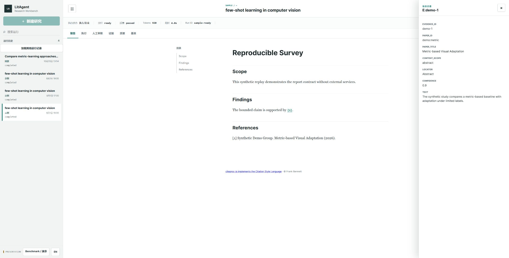
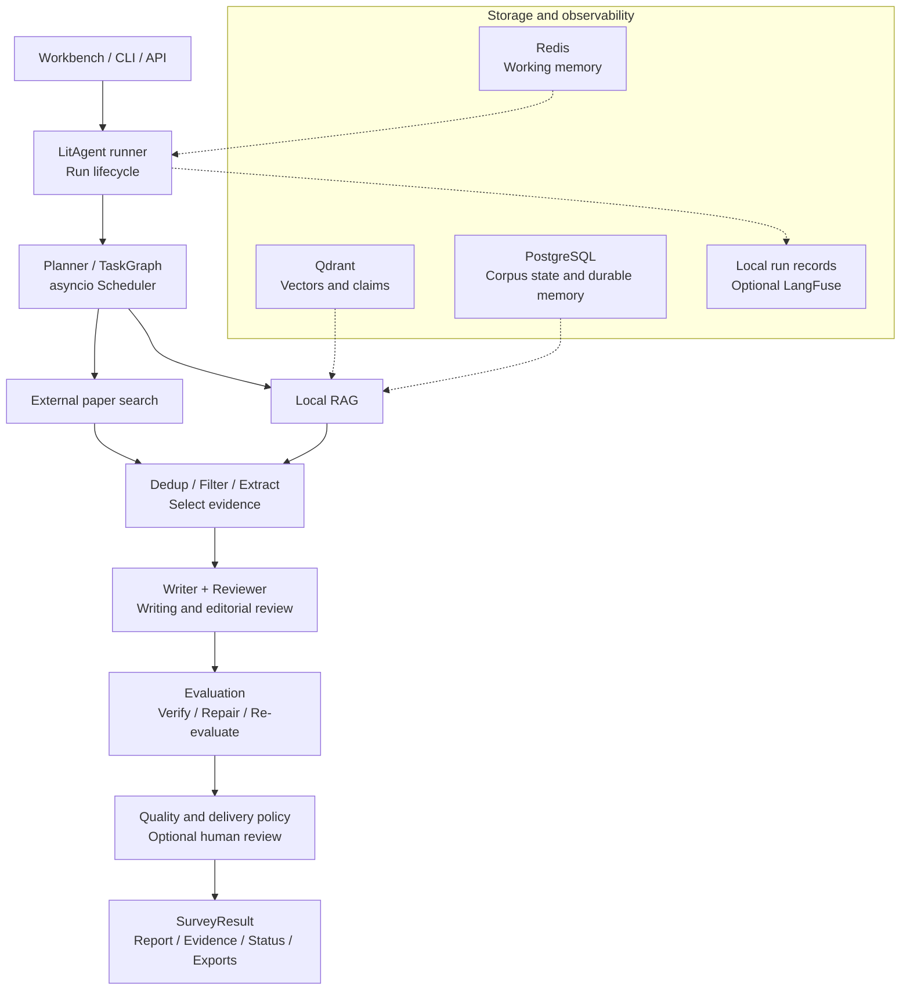

# LitAgent

[](./README.md)
[](./README.en.md)

**An evidence-grounded literature review system built around multi-agent collaboration.**

Turn a research question into paper retrieval, evidence extraction, review writing,
editorial review and verification. Inspect citations, evidence and quality status
in a research workbench with execution replay and local exports.

[Demo](#demo) · [Architecture](#architecture-and-stack) ·
[Experiments](#experiments-and-validation) · [Quick start](#quick-start)

> Reproducible engineering demonstration. Live Survey remains experimental;
> a formal 15-case baseline has not been established.

## Overview

Literature reviews require organizing multiple sources, checking whether citations
support claims, and preserving evidence across revisions. LitAgent models this work
as explicit tasks and binds each report to its evidence and verification results.

- **Input:** a research question, run configuration, and an optional local paper corpus.
- **Process:** external search and local RAG → deduplication and filtering → evidence extraction → writing and review → verification and bounded repair.
- **Output:** a structured review, references, evidence locations, quality and delivery status, and a run record.

## Demo



*Chinese UI captured from the current source using the synthetic `sample-ready` fixture.
This illustrates the interface and contracts, not model quality.*

After running `litagent demo --presentation`, open the
[workbench](http://127.0.0.1:8000/flow-demo) or
[evidence overview](http://127.0.0.1:8000/presentation). These addresses require a local server.

| View | What you can inspect |
| --- | --- |
| Report and evidence | Prose, numbered citations, source locations and references; Markdown/PDF/Word and BibTeX/RIS/CSL JSON exports |
| Execution and diagnostics | Task DAG, stage status, call timeline, errors and usage |
| Verification and revision | Version-bound evaluation, delivery reasons and a real frozen-evidence repair case |

[Three-minute walkthrough](./docs/presentation-guide.md) ·
[Historical video and version notes](./docs/presentation-guide.md#保存的演示材料)

## Core capabilities

- **Multi-agent collaboration:** explicit dependencies and asynchronous scheduling with separate search, extraction, writing and review responsibilities.
- **Hybrid retrieval:** external paper search plus a local Paper Corpus, supporting dense/BM25/RRF, optional reranking and full-text evidence.
- **Evidence-grounded verification:** preserve paper identities, evidence and source locations; distinguish valid citation IDs from actual support for a claim.
- **Human review and recovery:** optional paper-selection and final-report checkpoints reuse completed stages; human approval cannot override failed quality.
- **Reproducibility and diagnostics:** offline demonstration, versioned artifacts, request budgets and checkpoints, with optional LangFuse tracing.

## Architecture and stack



This is a capability-level overview; dotted edges represent resources or recording.
**Independent editorial and Evaluation repair loops** require explicit selection of
the policy in `config/separate-review-evaluation.yaml`; historical profiles retain
their behavior. See the [detailed flow](./docs/system-overview.md#independent-review-and-evaluation-loops)
for branches, stopping conditions and failure outcomes.

| Responsibility | Technology and boundary |
| --- | --- |
| Orchestration | Python 3.11, asyncio, custom TaskGraph/Scheduler; LangGraph implements the ReAct subflow, not the entire Survey DAG |
| Retrieval and corpus | Qdrant, dense/BM25/RRF, optional CrossEncoder, PyMuPDF; full-text chunks retain source locations |
| State and memory | Redis and PostgreSQL; local human review uses SQLite, with file-based run artifacts and checkpoints |
| Interfaces | FastAPI, SSE and the browser workbench; local citation styles and six export types |
| Observability and reproduction | Local RunArtifact, optional LangFuse, Docker Compose, offline tests and versioned benchmarks |

[Module responsibilities and contracts](./docs/system-overview.md) ·
[Capabilities and evidence](./docs/design-truth.md)

## Engineering decisions

| Problem | Design | Verification |
| --- | --- | --- |
| How do concurrent tasks handle dependencies and interruption? | Scheduler injects completed upstream outputs and models failure, cancellation and skipped states explicitly | [Orchestrator tests](./tests/test_orchestrator.py) |
| A citation exists, but does it support the claim? | Keep candidate findings separate from source evidence; check actual citations and preserve host-owned locations | [Evidence contracts](./docs/system-overview.md#paper-and-evidence-contracts) |
| How do editorial edits differ from factual repairs? | Explicit configuration selects separate loops and budgets; edited drafts remain unverified until Evaluation, and factual repairs undergo full re-evaluation | [Pipeline tests](./tests/test_separate_review_pipeline.py) |
| How are reports and scores kept aligned after revision or recovery? | Bind report SHA, evidence and evaluation; an improved but failing candidate is only a working draft, while publication still requires the complete quality gate | [Version and delivery contracts](./docs/system-overview.md#evaluation-and-delivery) |

## Experiments and validation

### Small retrieval benchmark

Fixed **25 papers, 15 queries, three repetitions per query**. Relevance judgments
are `source_reviewed`, without independent double annotation. Results describe
this dataset's retrieval and latency tradeoffs, not general academic search quality.

| Configuration | Recall@5 | nDCG@10 | p50 ms |
| --- | ---: | ---: | ---: |
| MiniLM + RRF | 0.8867 | 0.8238 | 14 |
| BM25 | 0.8778 | 0.8817 | 4 |
| MiniLM dense | 0.7711 | 0.7440 | 10 |
| RRF + reranker | 0.9089 | 0.9406 | 647 |
| Full-text section-aware | 0.9222 | 0.8426 | 61 |

Reranking improved ranking but increased latency, so this experiment did not change
the default configuration. Full-text profiles also change indexed material and are
not pure ranking ablations. [Full results and reproduction details](./benchmarks/rag/RESULTS.md).

### Real repair case and validation boundaries

A repair case used the same few-shot review and **31 frozen evidence items**. The
initial draft had nine unsupported scientific claims and failed the inventory
check. After revision, fresh claim extraction and full re-evaluation found support
from actual citations for 398/398 claims, meeting that case's strict delivery gate.
This is **one automatically evaluated frozen-evidence case**, without independent
human calibration. It establishes neither general accuracy nor a formal 15-case baseline.
[Case and usage notes](./docs/presentation-guide.md#最新状态与失败复盘) ·
[Public record](./src/litagent/static/presentation/frozen-repair-377-380.json).

| Validation layer | What it establishes |
| --- | --- |
| Offline tests and synthetic demo | Contracts, failure boundaries and UI behavior; not model quality |
| Retrieval benchmark | Recall, ranking and latency for a fixed corpus and queries |
| Real frozen-evidence case | Revision and verification for specific inputs, configuration and version |
| Formal Survey baseline | Not established; 0/15 formal cases completed |

Historical suites report generation, review, evaluation and delivery separately;
unexecuted cases are not scientific zero scores.
[Survey methodology and history](./benchmarks/survey/README.md) · [Historical closeout](./docs/closeout.md).

## Quick start

### Offline demonstration without API keys

Requires Python 3.11. Dependency installation needs internet access; the installed
demo needs no API key, Docker, model download or runtime network calls.

```sh
python -m venv .venv
# macOS / Linux
source .venv/bin/activate
# Windows PowerShell: .venv\Scripts\Activate.ps1
python -m pip install -c requirements/release-constraints.txt -e ".[api]"
litagent demo --presentation
```

Open the local URL printed in the terminal. Add `--no-browser --port 8001` if needed.
Presentation mode reads packaged records only, without scanning private archives or
recovering paid tasks. Built-in `ready`, `blocked` and `partial` samples are synthetic;
real cases are labeled separately.

### Optional live run

```sh
python -m pip install -c requirements/release-constraints.txt -e ".[dev]"
# Copy .env.example to .env and configure an OpenAI-compatible provider key.
docker compose up -d
litagent demo --live
```

Live runs incur model charges; `--live` and `--presentation` are mutually exclusive.
See the [environment example](./.env.example), [default configuration](./config/default.yaml)
and [independent-loop profile](./config/separate-review-evaluation.yaml). The new profile
requires explicit selection and is not automatically enabled by the command above.
Academic citation styles need Node.js; Chinese PDF/Word rendering needs CJK fonts.
See [runtime preparation](./docs/presentation-guide.md#启动与准备).

### Development checks

```sh
python -m pytest -v
python -m black --check src tests
python -m isort --check-only --profile black src tests
```

Default tests exclude `integration` and `live`; offline success does not establish scientific correctness.

## Status and documentation

Implemented engineering capabilities include retrieval, writing and review,
evidence tracing, quality and delivery policies, replay and export. Current work
focuses on controlled Survey validation and human calibration; no formal baseline
has been established. OCR and arbitrary-URL full-text acquisition are unsupported.
The project does not claim full PRISMA or journal-format compliance.

| Document | Contents |
| --- | --- |
| [System architecture](./docs/system-overview.md) | Responsibilities, data flow, two loops, persistence and degradation |
| [Demo guide](./docs/presentation-guide.md) | Setup, walkthrough, real case and historical media |
| [Capabilities and evidence](./docs/design-truth.md) | Implementation, verification links and experimental boundaries |
| [Retrieval results](./benchmarks/rag/RESULTS.md) / [Survey methodology](./benchmarks/survey/README.md) | Conditions, results and historical records |
| [Timeouts and cancellation](./docs/timeouts.md) / [Release criteria](./docs/release.md) | Runtime limits, acceptance checks and known boundaries |
