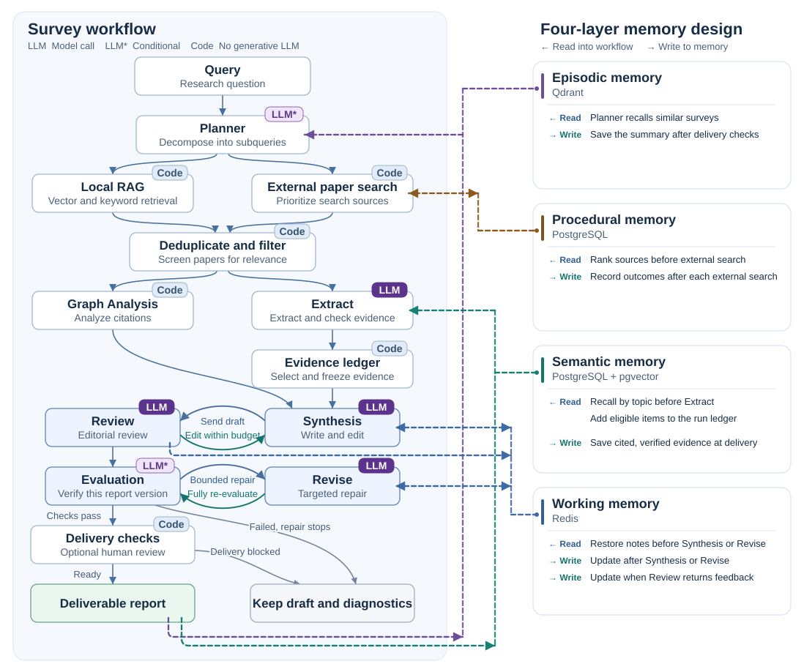
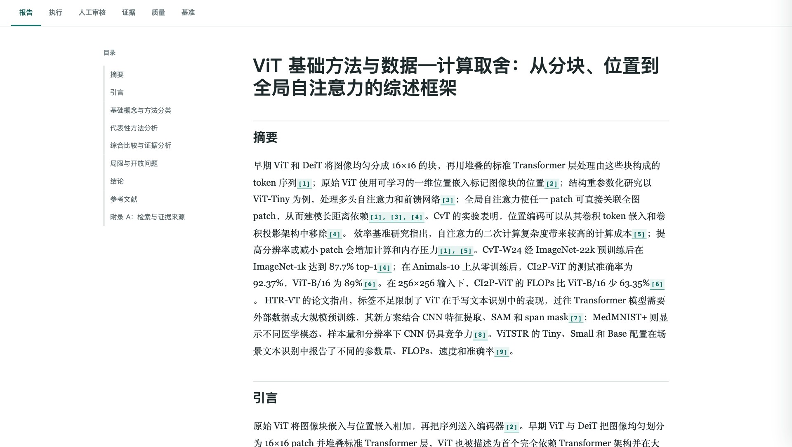

# LitAgent

[](./README.md)
[](./README.en.md)

**An evidence-grounded literature review system built around multi-agent collaboration.**

Find and organize papers around a research question, then write a literature review
with citations. Read reports, inspect sources, review revisions and export documents
from a single workbench.

[System Architecture](#system-architecture) · [Experiments](#experiments-and-validation) ·
[Demo](#demo) · [Quick start](#quick-start)

## Overview

LitAgent divides literature review work into retrieval, filtering, extraction,
writing and review tasks handled by collaborating agents. Each report retains its
sources, review history and evaluation results for inspection and revision.

- **Input:** a research question, run configuration, and an optional local paper corpus.
- **Process:** external search and local RAG → deduplication and filtering → evidence extraction → writing and review → verification and bounded repair.
- **Output:** a structured review, references, source locations, evaluation results and a run record.

## System Architecture



The left side shows the runtime workflow. External search and local RAG run in parallel, as do extraction and citation analysis. Colored dashed lines connect each memory layer to its workflow nodes. Arrows into a node indicate reads, and arrows toward memory indicate writes.
The `LLM` badge marks a generative model call. `LLM*` means the call depends on the task or configuration. `Code` marks steps without a generative LLM call. Retrieval and ranking can still use embedding or reranking models.
Working memory keeps decisions, open issues, and recent changes scoped by run, agent, and work unit.
Procedural memory counts successes, empty results, rate limits, and timeouts after each search.
After delivery checks pass, episodic memory stores the survey summary for future planning.

Semantic memory is read once before Extract using the research topic. The system checks recalled evidence and adds eligible items to the current evidence ledger. Writing, review, and evaluation use that ledger. After delivery checks pass, semantic memory stores the verified items cited by the final report.

## Core capabilities

- **Multi-agent collaboration:** schedule tasks asynchronously by dependency, with separate agents for search, extraction, writing and review.
- **Hybrid retrieval:** combine external paper search with a local corpus using dense retrieval, BM25, RRF fusion and reranking.
- **Citation verification:** link report claims to cited papers and source passages, then check whether the citations support each conclusion.
- **Human review:** review paper selections and final reports, and resume tasks from checkpoints.
- **Run tracing:** record task states, model calls and usage, with history replay and LangFuse support.

## Experiments and validation

### Retrieval benchmark

Using **25 papers, 15 queries and three repetitions per query**, the benchmark
compares recall, ranking quality and latency across retrieval configurations.

| Configuration | Recall@5 | nDCG@10 | p50 ms |
| --- | ---: | ---: | ---: |
| MiniLM + RRF | 0.8867 | 0.8238 | 14 |
| BM25 | 0.8778 | 0.8817 | 4 |
| MiniLM dense | 0.7711 | 0.7440 | 10 |
| RRF + reranker | 0.9089 | 0.9406 | 647 |
| Full-text section-aware | 0.9222 | 0.8426 | 61 |

RRF + reranker reached nDCG@10 of 0.9406 at 647 ms p50 latency, while MiniLM + RRF
returned results at 14 ms p50. The choice depends on ranking quality and response-time
requirements. The full-text profile uses section-aware chunking to compare retrieval
with different indexed material.

Pytest covers orchestration, evidence processing, evaluation and revision,
checkpoint recovery and API behavior.
Retrieval results and feature verification records are in `benchmarks/rag/RESULTS.md` and `docs/design-truth.md`.

## Demo



The screenshot shows a Vision Transformer survey from a live run. Re-evaluation found
support in the cited sources for 536 of 561 scientific claims (95.54%), so the draft
did not meet the strict delivery criteria.

## Quick start

### Offline demonstration without API keys

From the repository root, create and activate a Python 3.11 virtual environment. On macOS or Linux, run:

```sh
python3.11 -m venv .venv
source .venv/bin/activate
```

On Windows PowerShell, run:

```powershell
py -3.11 -m venv .venv
.\.venv\Scripts\Activate.ps1
```

Install the dependencies in the activated environment and start the demo. The first install requires internet access. Replay uses bundled data and needs no API key, Docker, or frontend build.

```sh
python -m pip install -c requirements/release-constraints.txt -e ".[api]"
litagent demo --presentation
```

Leave the terminal running. The command tries to open your browser. You can also open the [research workbench](http://127.0.0.1:8000/flow-demo) yourself.
Open the [sample execution graph](http://127.0.0.1:8000/flow-demo?run=sample%3Asample-ready&view=execution) and select a node to inspect its recorded inputs and outputs. The Evidence tab shows the evidence ledger, and the Report tab offers file exports. This sample includes the claim and extractor score. The source passage used for verification and the Jev confidence score were not recorded.
The [presentation page](http://127.0.0.1:8000/presentation) shows the benchmark results.

### Optional live run

Stop the offline demo with `Ctrl+C` and install the live dependencies in the same environment:

```sh
python -m pip install -c requirements/release-constraints.txt -e ".[dev]"
```

Start Docker. If you do not have a `.env` file yet, copy [.env.example](./.env.example) to `.env`.
Before submitting a survey, set `LLM_API_KEY` (or `OPENAI_API_KEY`) and verify that your provider URL and models match your account. The workbench defaults to [config/agent-format-repair.yaml](./config/agent-format-repair.yaml), which enables Jev verification and requires `TYPESAFE_API_KEY` for that step.

```sh
docker compose up -d
litagent demo --live
```

Return to the [research workbench](http://127.0.0.1:8000/flow-demo) and select **New research**. After submission, the Execution tab shows the current step and run status. Model calls incur provider charges.
To keep the offline demo running, activate the environment in a second terminal, run `litagent demo --live --port 8001`, and open the [live workbench on port 8001](http://127.0.0.1:8001/flow-demo).

### Development checks

```sh
python -m pytest -v
python -m black --check src tests
python -m isort --check-only --profile black src tests
```

Integration and live-model tests use the `integration` and `live` markers and can be run separately.
