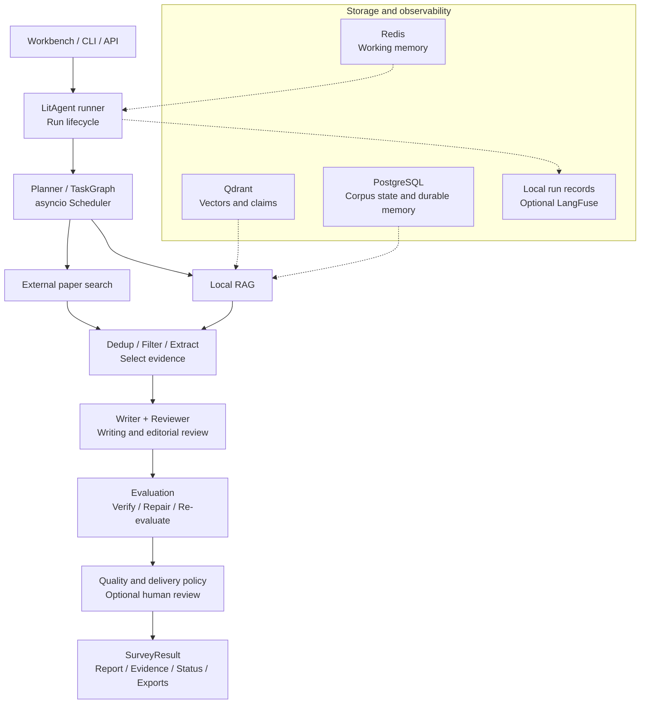

# LitAgent

[](./README.md)
[](./README.en.md)

**An evidence-grounded literature review system built around multi-agent collaboration.**

Find and organize papers around a research question, then write a literature review
with citations. Read reports, inspect sources, review revisions and export documents
from a single workbench.

[Demo](#demo) · [Architecture](#architecture-and-stack) ·
[Experiments](#experiments-and-validation) · [Quick start](#quick-start)

## Overview

LitAgent divides literature review work into retrieval, filtering, extraction,
writing and review tasks handled by collaborating agents. Each report retains its
sources, review history and evaluation results for inspection and revision.

- **Input:** a research question, run configuration, and an optional local paper corpus.
- **Process:** external search and local RAG → deduplication and filtering → evidence extraction → writing and review → verification and bounded repair.
- **Output:** a structured review, references, source locations, evaluation results and a run record.

## Demo


| View | Features |
| --- | --- |
| Report and evidence | Prose, numbered citations, source locations and references; Markdown/PDF/Word and BibTeX/RIS/CSL JSON exports |
| Execution and diagnostics | Task DAG, stage status, call timeline, errors and usage |
| Verification and revision | Evaluation results, revision history and report version comparison |

[Demo guide](./docs/presentation-guide.md) · [Demo video](./docs/images/demo-walkthrough.mp4)

## Core capabilities

- **Multi-agent collaboration:** schedule tasks asynchronously by dependency, with separate agents for search, extraction, writing and review.
- **Hybrid retrieval:** combine external paper search with a local corpus using dense retrieval, BM25, RRF fusion and reranking.
- **Citation verification:** link report claims to cited papers and source passages, then check whether the citations support each conclusion.
- **Human review:** review paper selections and final reports, and resume tasks from checkpoints.
- **Run tracing:** record task states, model calls and usage, with history replay and LangFuse support.

## Architecture and stack



Dotted edges represent storage and observability. The
[independent-loop profile](./config/separate-review-evaluation.yaml) provides separate
controls for Reviewer edits and Evaluation repairs.
[Detailed flow](./docs/system-overview.md#independent-review-and-evaluation-loops).

| Module | Technology |
| --- | --- |
| Orchestration | Python 3.11, asyncio, custom TaskGraph/Scheduler; LangGraph implements the ReAct subflow |
| Retrieval and corpus | Qdrant, dense/BM25/RRF, optional CrossEncoder, PyMuPDF; full-text chunks retain source locations |
| State and memory | Redis and PostgreSQL; local human review uses SQLite, with file-based run artifacts and checkpoints |
| Interfaces | FastAPI, SSE and the browser workbench; local citation styles and six export types |
| Observability and reproduction | Local RunArtifact, optional LangFuse, Docker Compose, offline tests and versioned benchmarks |

[Architecture guide](./docs/system-overview.md) ·
[Features and tests](./docs/design-truth.md)

## Engineering decisions

| Design | Implementation | Documentation and tests |
| --- | --- | --- |
| Asynchronous scheduling | Pass upstream results along DAG dependencies and handle failed, cancelled and skipped tasks consistently | [Orchestrator tests](./tests/test_orchestrator.py) |
| Claims linked to evidence | Preserve source locations and check each claim against its actual citations | [Evidence model](./docs/system-overview.md#paper-and-evidence-contracts) |
| Separate review and verification | Reviewer provides editorial feedback; Evaluation verifies independently, with separate revision budgets and re-evaluation after edits | [Pipeline tests](./tests/test_separate_review_pipeline.py) |
| Report version management | Associate prose, evidence and evaluation by SHA; retain revision history and checkpoints | [Version management](./docs/system-overview.md#evaluation-and-delivery) |

## Experiments and validation

### Retrieval benchmark

Using **25 papers, 15 queries and three repetitions per query**, the benchmark
compares recall, ranking quality and latency across retrieval configurations.

| Configuration | Recall@5 | nDCG@10 | p50 ms |
| --- | ---: | ---: | ---: |
| MiniLM + RRF | 0.8867 | 0.8238 | 14 |
| BM25 | 0.8778 | 0.8817 | 4 |
| MiniLM dense | 0.7711 | 0.7440 | 10 |
| RRF + reranker | 0.9089 | 0.9406 | 647 |
| Full-text section-aware | 0.9222 | 0.8426 | 61 |

RRF + reranker reached nDCG@10 of 0.9406 at 647 ms p50 latency, while MiniLM + RRF
returned results at 14 ms p50. The choice depends on ranking quality and response-time
requirements. The full-text profile uses section-aware chunking to compare retrieval
with different indexed material. [Full results](./benchmarks/rag/RESULTS.md).

### Review revision case

In one few-shot literature review, the system used **31 fixed evidence items** to
locate nine claims lacking citation support, then revised and re-evaluated the full
report. All 398 scientific claims extracted in that evaluation passed the system's
citation-support checks. [Case record](./src/litagent/static/presentation/frozen-repair-377-380.json).

Pytest covers orchestration, evidence processing, evaluation and revision,
checkpoint recovery and API behavior. See the
[Survey benchmark documentation](./benchmarks/survey/README.md) for methods and run records.

## Quick start

### Offline demonstration without API keys

Requires Python 3.11. Demo mode needs no API key or Docker.

```sh
python -m venv .venv
# macOS / Linux
source .venv/bin/activate
# Windows PowerShell: .venv\Scripts\Activate.ps1
python -m pip install -c requirements/release-constraints.txt -e ".[api]"
litagent demo --presentation
```

### Optional live run

```sh
python -m pip install -c requirements/release-constraints.txt -e ".[dev]"
# Copy .env.example to .env and configure an OpenAI-compatible provider key.
docker compose up -d
litagent demo --live
```

Live runs require a configured model service and incur charges from that provider.
See the [environment example](./.env.example) and [default configuration](./config/default.yaml).
Citation-style and document-export requirements are covered in the
[setup guide](./docs/presentation-guide.md#启动与准备).

### Development checks

```sh
python -m pytest -v
python -m black --check src tests
python -m isort --check-only --profile black src tests
```

Integration and live-model tests use the `integration` and `live` markers and can be run separately.

## Status and documentation

Next steps include expanding the evaluation set, improving long-report review and
revision, and optimizing retrieval quality and running costs.

| Document | Contents |
| --- | --- |
| [System architecture](./docs/system-overview.md) | Responsibilities, data flow, two loops, persistence and degradation |
| [Demo guide](./docs/presentation-guide.md) | Setup, walkthrough and demo materials |
| [Features and tests](./docs/design-truth.md) | Feature implementations and corresponding tests |
| [Retrieval results](./benchmarks/rag/RESULTS.md) / [Survey methodology](./benchmarks/survey/README.md) | Conditions, results and historical records |
| [Timeouts and cancellation](./docs/timeouts.md) / [Release criteria](./docs/release.md) | Runtime configuration and acceptance checks |
