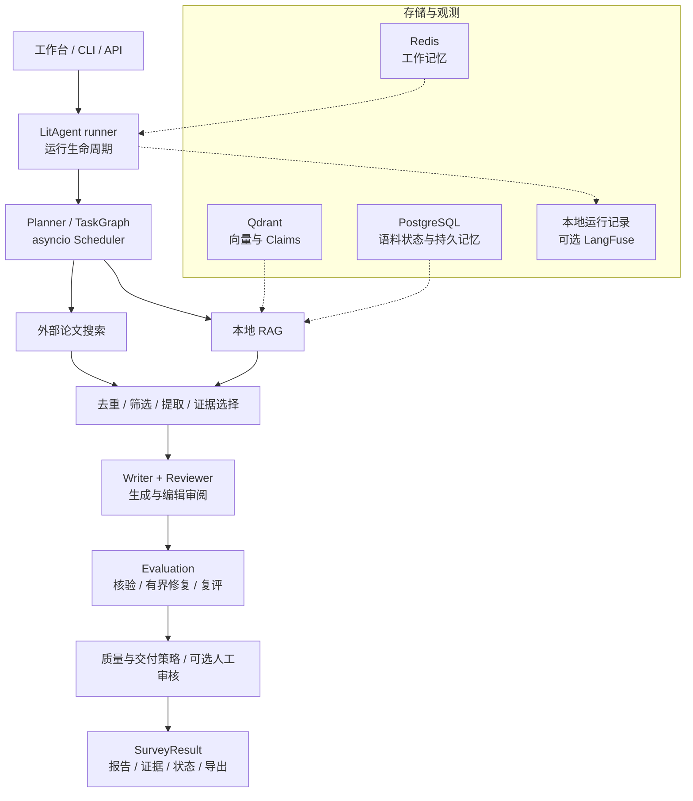

# LitAgent

[](./README.md)
[](./README.en.md)

**基于多 Agent 协作与证据约束的学术文献综述系统。**

输入研究问题，完成论文检索、证据提取、综述生成与审阅核验，输出可追溯引用、
可检查质量状态的报告。提供研究工作台、任务回放与本地导出。

[效果展示](#效果展示) · [系统架构](#系统架构与技术栈) ·
[实验结果](#实验与验证) · [快速开始](#快速开始)

> 当前提供可复现的工程演示；真实 Survey 仍属实验能力，正式 15 题基线尚未建立。

## 项目概览

文献综述的难点包括跨来源整理材料、核对论断与引文的关系，以及追踪多轮修订后的依据。
LitAgent 将这些工作拆为显式任务，并把报告、证据和核验结果绑定到同一版本。

- **输入**：研究问题、运行配置，以及可选的本地论文语料。
- **处理**：外部搜索与本地 RAG → 去重筛选 → 证据提取 → 生成审阅 → 核验与有界修复。
- **输出**：结构化综述、参考文献、证据定位、质量与交付状态，以及运行记录。

## 效果展示


*当前源码的离线演示截图，使用合成 `sample-ready` 夹具；用于展示界面与契约，不代表模型质量。*

运行 `litagent demo --presentation` 后打开[研究工作台](http://127.0.0.1:8000/flow-demo)
或[实验依据页](http://127.0.0.1:8000/presentation)。这些地址需要先在本机启动服务。

| 视角 | 可以查看什么 |
| --- | --- |
| 报告与证据 | 正文、编号引用、来源定位和参考文献；Markdown/PDF/Word 与 BibTeX/RIS/CSL JSON 导出 |
| 执行与诊断 | 任务 DAG、阶段状态、调用时间线、错误与用量 |
| 核验与修订 | 版本绑定的评估结果、交付原因，以及真实冻结证据修订案例 |

[三分钟演示指南](./docs/presentation-guide.md) ·
[历史演示视频与版本说明](./docs/presentation-guide.md#保存的演示材料)

## 核心能力

- **多 Agent 协作**：显式任务依赖与异步调度，分离搜索、提取、写作和审阅职责。
- **混合检索**：外部论文搜索与本地 Paper Corpus 结合，支持 dense/BM25/RRF、可选重排与全文证据。
- **证据约束与核验**：保留论文、证据和原文位置；区分引用 ID 有效性与实际引用对论断的支持。
- **人工审阅与恢复**：可选论文确认和终稿审核检查点；恢复时复用已完成阶段，人工认可不能覆盖质量失败。
- **可复现与可诊断**：离线演示、版本化 artifact、请求预算与 checkpoint，支持可选 LangFuse 追踪。

## 系统架构与技术栈



图中是能力层概览，虚线表示资源或记录关系。**独立编辑审阅循环与 Evaluation 修复循环**
需显式选择 `config/separate-review-evaluation.yaml` 对应策略；历史配置保留原行为。
分支、停止条件和失败出口见[详细流程图](./docs/system-overview.md#independent-review-and-evaluation-loops)。

| 职责 | 技术与边界 |
| --- | --- |
| 任务编排 | Python 3.11、asyncio、自定义 TaskGraph/Scheduler；LangGraph 用于 ReAct 子流程，不承担整个 Survey DAG |
| 检索与语料 | Qdrant、dense/BM25/RRF、可选 CrossEncoder、PyMuPDF；保留全文片段的来源位置 |
| 状态与记忆 | Redis、PostgreSQL；本地人工审核使用 SQLite，运行记录和 checkpoint 落盘 |
| 接口与展示 | FastAPI、SSE、浏览器研究工作台；本地引用样式与六类导出 |
| 观测与复现 | 本地 RunArtifact、可选 LangFuse、Docker Compose、离线测试与版本化 benchmark |

[模块职责与数据契约](./docs/system-overview.md) · [能力与证据清单](./docs/design-truth.md)

## 关键工程设计

| 问题 | 设计 | 验证入口 |
| --- | --- | --- |
| 多任务并发时如何处理依赖与中断？ | Scheduler 注入已完成的上游结果，显式处理失败、取消和跳过状态 | [编排测试](./tests/test_orchestrator.py) |
| 引用存在，但论断未获来源支持？ | 分离候选发现与原文证据，按实际引用核验论断，保留宿主定位 | [证据契约](./docs/system-overview.md#paper-and-evidence-contracts) |
| 审稿修改与事实修复如何分工？ | 显式配置启用两套循环及独立预算；编辑稿保持未核验，Evaluation 修复后完整复评 | [双循环链路测试](./tests/test_separate_review_pipeline.py) |
| 修订、恢复后如何避免报告与评分错配？ | 报告 SHA、证据与评估绑定；未通过但有改善的候选只作工作草稿，发布仍受完整质量门约束 | [版本与交付契约](./docs/system-overview.md#evaluation-and-delivery) |

## 实验与验证

### 小规模检索实验

固定 **25 篇论文、15 条查询，每条重复 3 次**；相关性标注为 `source_reviewed`，
未经过独立人工双审。下表描述该实验中的效果与延迟，不外推为通用学术检索能力。

| 配置 | Recall@5 | nDCG@10 | p50 ms |
| --- | ---: | ---: | ---: |
| MiniLM + RRF | 0.8867 | 0.8238 | 14 |
| BM25 | 0.8778 | 0.8817 | 4 |
| MiniLM dense | 0.7711 | 0.7440 | 10 |
| RRF + reranker | 0.9089 | 0.9406 | 647 |
| 全文 section-aware | 0.9222 | 0.8426 | 61 |

reranker 改善排名但增加延迟，因此该实验没有据此切换默认配置。全文实验同时改变索引材料，
不能把全部差异归因于排序算法。[完整结果与复现信息](./benchmarks/rag/RESULTS.md)。

### 真实修订案例与验证边界

同一份 few-shot 综述与 **31 条冻结证据**的修订案例中，初稿有 9 条不获支持的科学断言，
且清单检查未通过；修订后重新抽取并完整复评，398/398 条获实际引用支持，达到该案例的
严格交付要求。这是自动核验的**单题冻结证据案例**，没有独立人工校准，不代表普遍准确率，
也不计入正式 15 题基线。
[案例与用量说明](./docs/presentation-guide.md#最新状态与失败复盘) ·
[公开记录](./src/litagent/static/presentation/frozen-repair-377-380.json)。

| 验证层次 | 能说明什么 |
| --- | --- |
| 离线测试与合成演示 | 契约、失败边界和界面行为；不证明模型生成质量 |
| 检索实验 | 固定语料和查询上的召回、排名与延迟 |
| 真实冻结证据案例 | 指定输入、配置和版本下的修订与核验结果 |
| 正式 Survey 基线 | 尚未建立，已完成正式 case 为 0/15 |

历史固定套件的生成、审阅、核验和交付分别统计，未运行不记作科学零分。
[Survey 方法与历史](./benchmarks/survey/README.md) · [历史收尾记录](./docs/closeout.md)。

## 快速开始

### 无密钥离线演示

需要 Python 3.11。安装依赖需要网络；安装后演示不需要 API key、Docker、模型下载或运行时联网。

```sh
python -m venv .venv
# macOS / Linux
source .venv/bin/activate
# Windows PowerShell: .venv\Scripts\Activate.ps1
python -m pip install -c requirements/release-constraints.txt -e ".[api]"
litagent demo --presentation
```

打开终端显示的本机地址；可加 `--no-browser --port 8001`。
公开演示只读随包记录，不扫描私人归档、不恢复付费任务。
`ready`、`blocked`、`partial` 内置样例是合成夹具；真实案例另行标注。

### 可选真实运行

```sh
python -m pip install -c requirements/release-constraints.txt -e ".[dev]"
# 复制 .env.example 为 .env，填写 OpenAI-compatible provider key。
docker compose up -d
litagent demo --live
```

真实运行会产生模型费用；`--live` 与 `--presentation` 互斥。
配置入口见[环境变量示例](./.env.example)、[默认配置](./config/default.yaml)及
[独立双循环配置](./config/separate-review-evaluation.yaml)。新配置需要显式选择，不由上述命令自动启用。
学术引用样式需要 Node.js，中文 PDF/Word 需要 CJK 字体，详见[运行准备](./docs/presentation-guide.md#启动与准备)。

### 开发验证

```sh
python -m pytest -v
python -m black --check src tests
python -m isort --check-only --profile black src tests
```

默认测试排除 `integration` 和 `live`；离线通过不代表科学内容正确。

## 项目状态与文档导航

已提供检索、生成审阅、证据追溯、质量与交付策略、回放和导出等工程能力。
当前重点是受控 Survey 验证与人工校准；正式基线尚未建立。不支持 OCR、任意 URL 全文抓取，
不宣称完整 PRISMA 或投稿格式合规。

| 文档 | 内容 |
| --- | --- |
| [系统架构](./docs/system-overview.md) | 模块职责、数据流、双循环、持久化与降级 |
| [演示指南](./docs/presentation-guide.md) | 启动准备、讲解路径、真实案例与历史素材 |
| [能力与证据](./docs/design-truth.md) | 已实现能力、验证入口与实验边界 |
| [检索结果](./benchmarks/rag/RESULTS.md) / [Survey 方法](./benchmarks/survey/README.md) | 实验条件、结果与历史记录 |
| [超时与取消](./docs/timeouts.md) / [发布验收](./docs/release.md) | 运行限制、验收方式与已知边界 |
