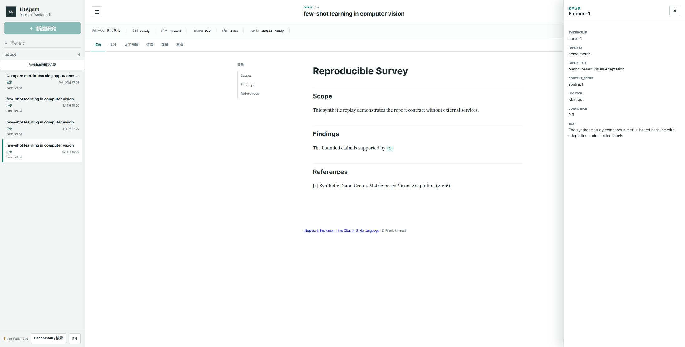
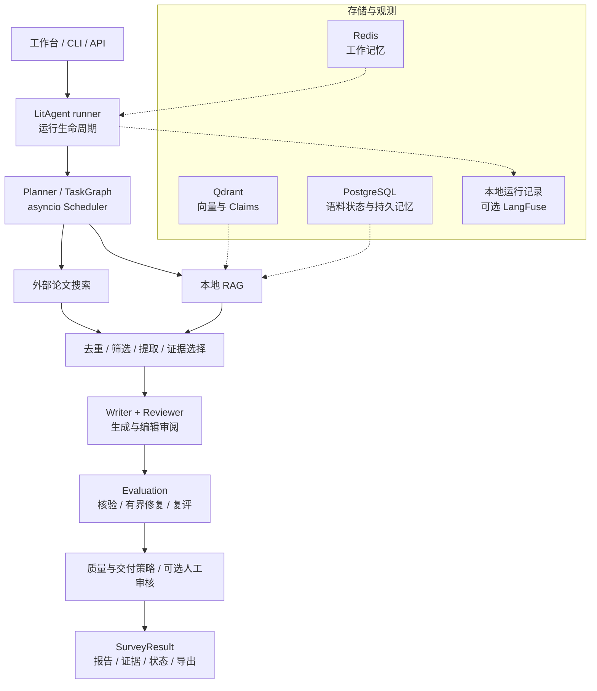

# LitAgent

[](./README.md)
[](./README.en.md)

**基于多 Agent 协作与证据约束的学术文献综述系统。**

围绕研究问题检索和整理相关论文，生成带引用的文献综述。
支持报告阅读、原文追溯、审阅修订和多格式导出。

[效果展示](#效果展示) · [系统架构](#系统架构与技术栈) ·
[实验结果](#实验与验证) · [快速开始](#快速开始)

## 项目概览

LitAgent 将文献综述流程拆分为检索、筛选、提取、写作和审阅等任务，由不同 Agent 协作完成。
每份报告都保留引用来源、审阅记录和评估结果，方便阅读、核查与后续修改。

- **输入**：研究问题、运行配置，以及可选的本地论文语料。
- **处理**：外部搜索与本地 RAG → 去重筛选 → 证据提取 → 写作审阅 → 核验修订。
- **输出**：结构化综述、参考文献、原文定位、评估结果和运行记录。

## 效果展示



| 页面 | 功能 |
| --- | --- |
| 报告与证据 | 正文、编号引用、来源定位和参考文献；Markdown/PDF/Word 与 BibTeX/RIS/CSL JSON 导出 |
| 执行与诊断 | 任务 DAG、阶段状态、调用时间线、错误与用量 |
| 核验与修订 | 评估结果、修订历史和报告版本对比 |

[演示指南](./docs/presentation-guide.md)

## 核心能力

- **多 Agent 协作**：按任务依赖异步调度，分别完成搜索、提取、写作和审阅。
- **混合检索**：结合外部论文搜索与本地语料，支持 dense、BM25、RRF 融合和重排。
- **引用核验**：关联报告论断、引用文献和原文片段，检查引用是否支持对应结论。
- **人工审阅**：支持论文选择和终稿审核，可从检查点恢复任务。
- **运行追踪**：记录任务状态、模型调用和用量，支持历史回放与 LangFuse 追踪。

## 系统架构与技术栈



虚线表示存储与观测关系。通过[双循环配置](./config/separate-review-evaluation.yaml)，
可分别控制 Reviewer 审阅修订和 Evaluation 核验修复。
[详细流程](./docs/system-overview.md#independent-review-and-evaluation-loops)。

| 模块 | 技术 |
| --- | --- |
| 任务编排 | Python 3.11、asyncio、自定义 TaskGraph/Scheduler；LangGraph 实现 ReAct 子流程 |
| 检索与语料 | Qdrant、dense/BM25/RRF、可选 CrossEncoder、PyMuPDF；保留全文片段的来源位置 |
| 状态与记忆 | Redis、PostgreSQL；本地人工审核使用 SQLite，运行记录和 checkpoint 落盘 |
| 接口与展示 | FastAPI、SSE、浏览器研究工作台；本地引用样式与六类导出 |
| 观测与复现 | 本地 RunArtifact、可选 LangFuse、Docker Compose、离线测试与版本化 benchmark |

[架构说明](./docs/system-overview.md) · [功能与测试索引](./docs/design-truth.md)

## 关键工程设计

| 设计 | 实现 | 相关文档与测试 |
| --- | --- | --- |
| 异步任务调度 | 按 DAG 依赖传递上游结果，统一处理任务失败、取消和跳过 | [编排测试](./tests/test_orchestrator.py) |
| 论断与证据关联 | 保存原文位置，逐条检查论断与实际引用的关系 | [证据模型](./docs/system-overview.md#paper-and-evidence-contracts) |
| 审阅与核验分工 | Reviewer 提出编辑意见，Evaluation 独立核验；两类修订分别计账，修订后重新评估 | [双循环测试](./tests/test_separate_review_pipeline.py) |
| 报告版本管理 | 用 SHA 关联正文、证据和评估结果，保留修订历史与检查点 | [版本管理](./docs/system-overview.md#evaluation-and-delivery) |

## 实验与验证

### 检索实验

使用 **25 篇论文、15 条查询，每条重复 3 次**，比较不同检索配置的召回率、排序质量和延迟。

| 配置 | Recall@5 | nDCG@10 | p50 ms |
| --- | ---: | ---: | ---: |
| MiniLM + RRF | 0.8867 | 0.8238 | 14 |
| BM25 | 0.8778 | 0.8817 | 4 |
| MiniLM dense | 0.7711 | 0.7440 | 10 |
| RRF + reranker | 0.9089 | 0.9406 | 647 |
| 全文 section-aware | 0.9222 | 0.8426 | 61 |

RRF + reranker 的 nDCG@10 达到 0.9406，p50 延迟为 647 ms；MiniLM + RRF
的 p50 为 14 ms，可根据排序质量和响应速度的需求选择。全文配置采用 section-aware 切分，
单独比较不同索引材料下的检索表现。[完整实验结果](./benchmarks/rag/RESULTS.md)。

### 综述修订案例

在一次 few-shot 文献综述修订中，系统基于 **31 条固定证据**定位了 9 条缺少引用支持的论断，
随后完成正文修订与全文复评。该次复评重新提取的 398 条科学论断全部通过系统的引用支持检查。
[查看案例](./src/litagent/static/presentation/frozen-repair-377-380.json)。

项目使用 pytest 覆盖任务编排、证据处理、评估修订、断点恢复及 API 行为。
评测方法与运行记录见 [Survey 评测文档](./benchmarks/survey/README.md)。

## 快速开始

### 无密钥离线演示

需要 Python 3.11。演示模式无需 API key 或 Docker。

```sh
python -m venv .venv
# macOS / Linux
source .venv/bin/activate
# Windows PowerShell: .venv\Scripts\Activate.ps1
python -m pip install -c requirements/release-constraints.txt -e ".[api]"
litagent demo --presentation
```

### 可选真实运行

```sh
python -m pip install -c requirements/release-constraints.txt -e ".[dev]"
# 复制 .env.example 为 .env，填写 OpenAI-compatible provider key。
docker compose up -d
litagent demo --live
```

真实运行需要配置模型服务，费用由所选服务商收取。
配置方式见[环境变量示例](./.env.example)与[默认配置](./config/default.yaml)。
引用样式和文档导出的环境要求见[安装说明](./docs/presentation-guide.md#启动与准备)。

### 开发验证

```sh
python -m pytest -v
python -m black --check src tests
python -m isort --check-only --profile black src tests
```

集成测试与真实模型测试使用 `integration`、`live` 标记，按需单独运行。

## 项目状态与文档导航

后续将扩充评测集，完善长文审阅与修订流程，并持续优化检索质量和运行成本。

[完整文档索引](./docs/README.md)

| 文档 | 内容 |
| --- | --- |
| [系统架构](./docs/system-overview.md) | 模块职责、数据流、双循环、持久化与降级 |
| [演示指南](./docs/presentation-guide.md) | 环境准备、操作流程与演示材料 |
| [功能与测试索引](./docs/design-truth.md) | 功能实现与对应测试 |
| [检索结果](./benchmarks/rag/RESULTS.md) / [Survey 方法](./benchmarks/survey/README.md) | 实验条件、结果与历史记录 |
| [超时与取消](./docs/timeouts.md) / [发布验收](./docs/release.md) | 运行配置与验收方式 |
