# LitAgent

[](./README.md)
[](./README.zh-CN.md)

An evidence-grounded literature-review workbench with an asynchronous multi-agent
DAG, hybrid retrieval, adversarial review, and version-bound evaluation.

**Engineering demonstration; live Survey remains experimental.** The retrieval
benchmark is measured. A formal 15-case Survey baseline has not been established.
An execution finishing does not mean its report passed quality checks.

## Start the public demonstration

Python 3.11 is required. Install dependencies with internet access, then run the
presentation without API keys, Docker, model downloads, or runtime network calls:

```sh
python -m venv .venv
# macOS / Linux
source .venv/bin/activate
# Windows PowerShell: .venv\Scripts\Activate.ps1
python -m pip install -c requirements/release-constraints.txt -e ".[api]"
litagent demo --presentation
```

Open [the workbench](http://127.0.0.1:8000/flow-demo) or
[the evidence overview](http://127.0.0.1:8000/presentation).
Use `--no-browser --port 8001` when needed. `--presentation` and `--live` are
mutually exclusive. Presentation mode loads only packaged public records, denies
writes, and does not scan private archives or recover paid tasks.

Three built-in `ready`, `blocked`, and `partial` samples are **synthetic contract
fixtures**, not model-quality measurements. A separate real failure replay shows
why delivery was blocked. [Demo and technical walkthrough](./docs/presentation-guide.md).

For local private archives, the existing `litagent demo` command remains available.

## What the system does

```mermaid
flowchart LR
    Q[Research question] --> P[Planner / bounded DAG]
    P --> S[External search + local RAG]
    S --> E[Dedup / relevance / extraction]
    E --> F[Fact cards / optional extraction Jev]
    F --> W[Synthesis / Reviewer]
    W --> V[Evaluation / bounded repair]
    V --> D[Quality / delivery policy]
    D --> UI[Versioned report / evidence / replay]
```



- Sources, complete selected support text, and host-generated locators remain
  distinct from model-extracted findings; a valid card is not a verified fact.
- Evaluation verifies atomic claims against their actual citations. Candidate
  rewrites stay isolated until complete re-evaluation succeeds.
- Report versions, evidence, SHA, quality and delivery are bound together.
  Incomplete, unsupported or interrupted outputs cannot silently become publishable.
- Fixed request/token budgets, zero automatic retries for controlled trials,
  durable checkpoints, and conservative unknown-usage accounting limit paid work.
- Local artifacts retain detailed diagnostics; current controlled runs send only
  redacted metadata and usage to optional LangFuse.
- `academic_v2` has seven academic sections and a host-managed retrieval appendix.
  IEEE, APA 7 and GB/T citation styles are deterministic local projections.
  Markdown/PDF/Word and BibTeX/RIS/CSL JSON exports do not call an LLM.

[Architecture and ownership](./docs/system-overview.md) ·
[Capability/evidence ledger](./docs/design-truth.md).

## Measured results

Retrieval: **25 papers, 15 queries, 3 repetitions per query**, source-reviewed
judgments without independent human double review; not a general retrieval ranking.

| Profile | Recall@5 | nDCG@10 | p50 ms |
| --- | ---: | ---: | ---: |
| MiniLM + RRF | 0.8867 | 0.8238 | 14 |
| BM25 | 0.8778 | 0.8817 | 4 |
| MiniLM dense | 0.7711 | 0.7440 | 10 |
| RRF + reranker | 0.9089 | 0.9406 | 647 |
| Fulltext section-aware | 0.9222 | 0.8426 | 61 |

Reranking improves ranking metrics but adds substantial latency; it is not the
default. Full-text profiles change indexed material and are separate from pure
ranking comparisons. [Full results and limitations](./benchmarks/rag/RESULTS.md).

### Live frozen-evidence repair case

**377 → 380** reused 31 frozen evidence items for a single few-shot survey.
The rejected candidate had 330 of 339 scientific assertions supported and
9 unsupported. An unresolved inventory finding left its formal Faithfulness
score unavailable. One additional prose repair and a full re-evaluation
produced a deliverable version with **398 of 398 supported, 0 unsupported,
0 unverified**. The continuation settled **9 requests and 188,560 tokens**,
with zero unknown hold. The report and its evaluation share the same SHA-256.

Open the case from the workbench's **Benchmark** tab or the public presentation
to trace each of the nine rejected assertions to its passage and cited papers.
This single frozen-evidence result is tracked separately from normal Survey runs
and the formal benchmark. The two versions have independently extracted assertion
inventories. [Interactive case](http://127.0.0.1:8000/static/presentation/frozen-repair-377-380.html)
· [Public data and receipt hashes](./src/litagent/static/presentation/frozen-repair-377-380.json).

### Historical fixed closeout

Fixed closeout trial **055** planned three cases and ran one: **1/3 body
and summaries generated, 0/3 Reviewers completed, 0/3 valid complete Evaluations,
0/3 strict deliveries**. The few-shot Reviewer exhausted its 4,096 output-token
limit with thinking disabled. The suite stopped as specified; ViT and NeRF remain
unrun in the denominator. **7 requests / 96,102 known tokens / no new unknown usage**.
This is an output-capacity failure, not evidence of a scientific score of zero.

The historical, SHA-verified draft is available as **unreviewed and unevaluated**
material in the presentation. [Historical results and source bindings](./src/litagent/static/presentation/closeout.json)
· [Engineering status and limitations](./docs/closeout.md).

Formal Survey cases remain **0/15**; no independently human-calibrated accuracy is
available. Historical charges and unknown holds are retained separately.

[Current Survey status and release boundary](./docs/closeout.md) ·
[Survey methodology and historical trials](./benchmarks/survey/README.md) ·
[Packaged public records](./src/litagent/static/presentation/manifest.json).

## Optional live use

```sh
python -m pip install -c requirements/release-constraints.txt -e ".[dev]"
# Copy .env.example to .env and set an OpenAI-compatible provider key.
docker compose up -d
litagent demo --live
```

The current configuration routes extraction/planning/review/Evaluation to
`doubao-seed-2-1-lite-260915`, and generation/repairs to
`doubao-seed-2-1-pro-260915`. Model access and paid usage are your responsibility.
The new UI uses `strict_auto_v2`, Chinese, `academic_v2`, and IEEE; legacy API
requests retain legacy defaults.

Mandatory Evaluation v3 checks full unit coverage, scientific support, structure,
core coverage and global consistency. `citation_accuracy` means **citation ID
validity**, not semantic correctness. Strict delivery requires scientific support
1.0; the historical 0.8 base threshold remains a separate metric.
Judge and pre-writing extraction Jev are independent optional switches, off in the
new UI. Enabled checks must pass. Judge using a generation-family model is
`self_judged`; Jev confidence is not accuracy. No independent human calibration
has been completed. [Configuration example](./.env.example).

Stage-specific request and Worker deadlines are configured in `config/default.yaml`;
see [timeout settings and cancellation accounting](./docs/timeouts.md).

Academic styles require Node.js (validated locally with 24.14.0). PDF/Word Chinese
rendering requires a CJK font; see the demo guide. There is no OCR, arbitrary-URL
PDF crawling, or submission-format certification.

## Verify

```sh
python -m pytest -v
python -m black --check src tests
python -m isort --check-only --profile black src tests
```

Default tests exclude `integration` and `live`; they do not prove scientific
accuracy. [Release checklist and known limitations](./docs/release.md).

[2026-10-20 release validation / 收尾验收](./docs/release-status.md).

[Screenshot / short screen-capture walkthrough](./docs/presentation-guide.md#保存的演示材料).
