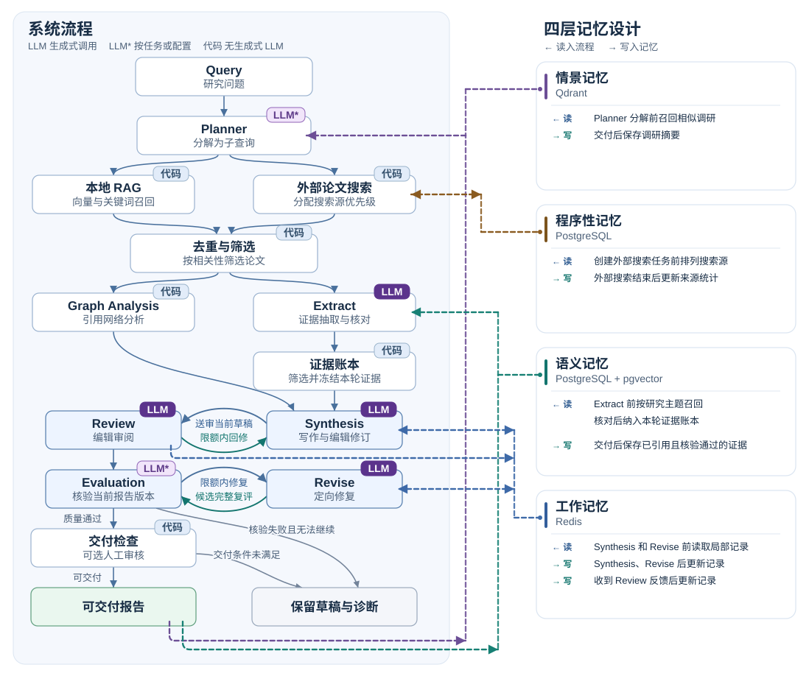
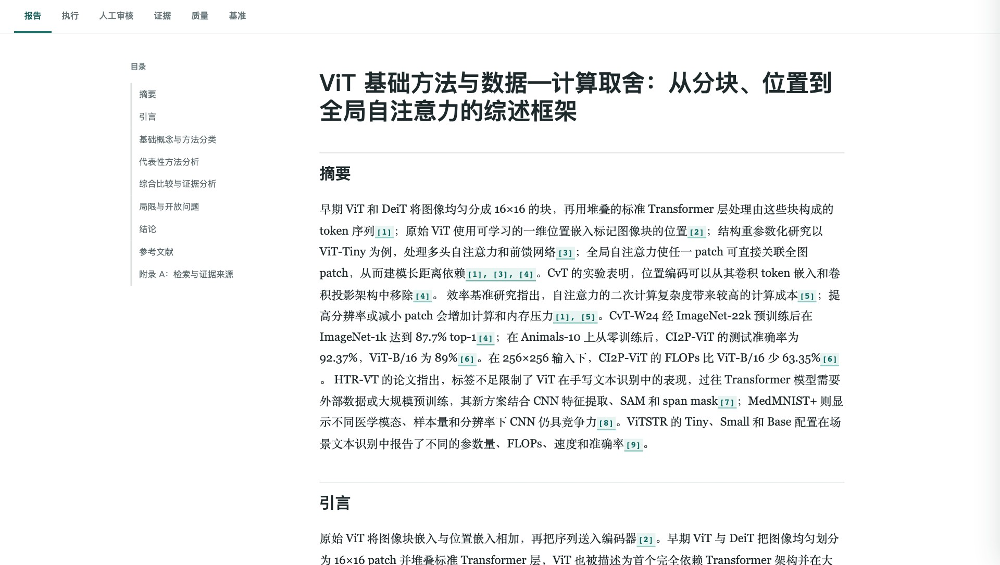

# LitAgent

[](./README.md)
[](./README.en.md)

**基于多 Agent 协作与证据约束的学术文献综述系统。**

围绕研究问题检索和整理相关论文，生成带引用的文献综述。
支持报告阅读、原文追溯、审阅修订和多格式导出。

[系统架构](#系统架构) · [实验结果](#实验与验证) ·
[效果展示](#效果展示) · [快速开始](#快速开始)

## 项目概览

LitAgent 将文献综述流程拆分为检索、筛选、提取、写作和审阅等任务，由不同 Agent 协作完成。
每份报告都保留引用来源、审阅记录和评估结果，方便阅读、核查与后续修改。

- **输入**：研究问题、运行配置，以及可选的本地论文语料。
- **处理**：外部搜索与本地 RAG → 去重筛选 → 证据提取 → 写作审阅 → 核验修订。
- **输出**：结构化综述、参考文献、原文定位、评估结果和运行记录。

## 系统架构



左侧是运行流程。外部论文搜索与本地 RAG 并行，证据抽取与引用网络分析并行。右侧四层记忆通过同色虚线接到使用节点，箭头指向节点表示读取，指向记忆表示写入。
节点角标中，`LLM` 表示调用生成式模型，`LLM*` 表示按任务或配置调用，`代码` 表示该步骤无生成式 LLM 调用。检索和排序仍可使用向量模型或重排模型。
工作记忆按运行、Agent 和工作单元隔离，记录已采纳的决定、待解决问题和近期改动。
程序性记忆在搜索结束后累计成功、空结果、限流和超时。情景记忆在报告满足交付条件后保存调研摘要，供下一次规划召回。

语义记忆统一在 Extract 前按研究主题召回。系统核对来源和适用条件后，将符合条件的证据纳入本轮账本，供后续写作、审阅和评估使用。报告满足交付条件后，只将最终版本实际引用且核验通过的证据写入语义记忆。

## 核心能力

- **多 Agent 协作**：按任务依赖异步调度，分别完成搜索、提取、写作和审阅。
- **混合检索**：结合外部论文搜索与本地语料，支持 dense、BM25、RRF 融合和重排。
- **引用核验**：关联报告论断、引用文献和原文片段，检查引用是否支持对应结论。
- **人工审阅**：支持论文选择和终稿审核，可从检查点恢复任务。
- **运行追踪**：记录任务状态、模型调用和用量，支持历史回放与 LangFuse 追踪。

## 实验与验证

### 检索实验

使用 **25 篇论文、15 条查询，每条重复 3 次**，比较不同检索配置的召回率、排序质量和延迟。

| 配置 | Recall@5 | nDCG@10 | p50 ms |
| --- | ---: | ---: | ---: |
| MiniLM + RRF | 0.8867 | 0.8238 | 14 |
| BM25 | 0.8778 | 0.8817 | 4 |
| MiniLM dense | 0.7711 | 0.7440 | 10 |
| RRF + reranker | 0.9089 | 0.9406 | 647 |
| 全文 section-aware | 0.9222 | 0.8426 | 61 |

RRF + reranker 的 nDCG@10 达到 0.9406，p50 延迟为 647 ms；MiniLM + RRF
的 p50 为 14 ms，可根据排序质量和响应速度的需求选择。全文配置采用 section-aware 切分，
单独比较不同索引材料下的检索表现。

项目使用 pytest 覆盖任务编排、证据处理、评估修订、断点恢复及 API 行为。
检索结果和功能验证记录分别保存在 `benchmarks/rag/RESULTS.md` 和 `docs/design-truth.md`。

## 效果展示



截图来自一次真实的 Vision Transformer 文献综述运行。复评中，561 条科学断言有 536 条获实际引用支持（95.54%），这版草稿未达到严格交付标准。

## 快速开始

### 无密钥离线演示

在仓库根目录使用 Python 3.11 创建并激活虚拟环境。macOS / Linux 用户运行：

```sh
python3.11 -m venv .venv
source .venv/bin/activate
```

Windows PowerShell 用户运行：

```powershell
py -3.11 -m venv .venv
.\.venv\Scripts\Activate.ps1
```

在已激活的环境中安装依赖并启动演示。首次安装需要联网；回放使用随项目提供的数据，无需 API key、Docker 或前端构建。

```sh
python -m pip install -c requirements/release-constraints.txt -e ".[api]"
litagent demo --presentation
```

保持终端运行。命令会尝试打开浏览器，也可以手动打开[研究工作台](http://127.0.0.1:8000/flow-demo)。
直接进入[示例执行图](http://127.0.0.1:8000/flow-demo?run=sample%3Asample-ready&view=execution)，点击节点查看已记录的输入和输出，切换到「证据」查看证据详情，或在「报告」中导出文件。此示例保留了 claim 和提取器评分，未保存核验原文与 Jev 置信度。
基准结果可在[工程演示页](http://127.0.0.1:8000/presentation)查看。

### 可选真实运行

按 `Ctrl+C` 停止离线演示，在同一虚拟环境中安装 Live 依赖：

```sh
python -m pip install -c requirements/release-constraints.txt -e ".[dev]"
```

启动 Docker。如果尚无 `.env`，将 [.env.example](./.env.example) 复制为 `.env`。
提交真实研究前，填写 `LLM_API_KEY`（或 `OPENAI_API_KEY`），并确认服务地址和模型与你的账号匹配。工作台默认使用 [config/agent-format-repair.yaml](./config/agent-format-repair.yaml)，其中启用的 Jev 核验还需要 `TYPESAFE_API_KEY`。

```sh
docker compose up -d
litagent demo --live
```

回到[研究工作台](http://127.0.0.1:8000/flow-demo)，点击「新建研究」。提交后在「执行」中查看当前步骤和运行状态，模型调用按服务商计费。
若要同时保留离线演示，可在另一个已激活虚拟环境的终端运行 `litagent demo --live --port 8001`，打开 [8001 端口的 Live 工作台](http://127.0.0.1:8001/flow-demo)。

### 开发验证

```sh
python -m pytest -v
python -m black --check src tests
python -m isort --check-only --profile black src tests
```

集成测试与真实模型测试使用 `integration`、`live` 标记，按需单独运行。
