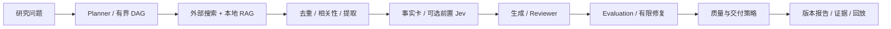

# LitAgent

[](./README.md)
[](./README.zh-CN.md)

基于异步多 Agent DAG、混合检索、对抗审阅与版本化核验的证据约束型文献综述工作台。

**当前交付工程演示版本，live Survey 仍属实验能力。** 检索实验已有实测结果，正式
15 题 Survey baseline 尚未建立。“执行结束”不等于“正文通过核验”。

## 快速启动公开演示

需要 Python 3.11。依赖安装需要联网；安装后演示不需要 API key、Docker、模型下载或运行时联网。

```sh
python -m venv .venv
# macOS / Linux
source .venv/bin/activate
# Windows PowerShell: .venv\Scripts\Activate.ps1
python -m pip install -c requirements/release-constraints.txt -e ".[api]"
litagent demo --presentation
```

打开[研究工作台](http://127.0.0.1:8000/flow-demo)或
[工程演示与实验依据](http://127.0.0.1:8000/presentation)。可加 `--no-browser --port 8001`。
`--presentation` 与 `--live` 互斥：仅加载随包公开记录，拒绝所有写操作，不扫描私人归档、
不创建交互数据库、不恢复任务，也不初始化付费服务。

内置 `ready`、`blocked`、`partial` 是**合成契约夹具，不是模型质量证明**；另提供真实
失败记录，展示定位和阻止交付。私人归档仍可用既有 `litagent demo` 查看。
[三分钟演示与技术讲解](./docs/presentation-guide.md)。

## 核心流程与工程特点



- 模型提取的候选发现与完整原文、宿主生成的位置分开保存；卡 ID 合法不代表事实正确。
- Evaluation 只用断言实际引用的证据；修订候选完整复评后才能原子提交。
- 正文、证据、版本 SHA、评分与交付绑定，失败和中断不能自动变为可发布。
- 固定预算、受控实验零自动重试、持久 checkpoint、未知 usage 保守占用，避免重启重复付费。
- 详细诊断留在本地；当前受控运行仅向可选 LangFuse 发送脱敏元数据和 usage。
- `academic_v2` 七章正文加程序生成的检索附录；IEEE、APA 7、GB/T 样式由本地引擎渲染。
  Markdown/PDF/Word、BibTeX/RIS/CSL JSON 导出不调用模型。

[架构与资源职责](./docs/system-overview.md) · [能力与证据清单](./docs/design-truth.md)。

## 已测结果

检索实验：**25 篇论文、15 条查询、每条重复 3 次**。相关性标注为 source_reviewed，
未独立人工双审，不代表通用学术检索排名。

| 配置 | Recall@5 | nDCG@10 | p50 ms |
| --- | ---: | ---: | ---: |
| MiniLM + RRF | 0.8867 | 0.8238 | 14 |
| BM25 | 0.8778 | 0.8817 | 4 |
| MiniLM dense | 0.7711 | 0.7440 | 10 |
| RRF + reranker | 0.9089 | 0.9406 | 647 |
| 全文 section-aware | 0.9222 | 0.8426 | 61 |

reranker 改善排名但显著增加延迟，因此没有切为默认。全文配置同时改变索引材料，
不能把差异全部归因于排名算法。[完整结果与解释边界](./benchmarks/rag/RESULTS.md)。

Survey 最新公开诊断：试点 **1/3**、**27 请求／126,023 tokens**，Pro JSON 非法，
**Evaluation 未运行**；正式 **0/15**。这是技术失败，不能当作科学支持率零分。
历史单次 NeRF 在旧策略下交付成功，不代表当前严格策略成功，也不证明质量增益。
[最新有界试点](./benchmarks/survey/results/survey-reliability-20261021-001/README.md) ·
[Survey 方法与历史](./benchmarks/survey/README.md) ·
[公开包来源绑定](./src/litagent/static/presentation/manifest.json)。

## 可选真实运行

```sh
python -m pip install -c requirements/release-constraints.txt -e ".[dev]"
# 复制 .env.example 为 .env，填写 OpenAI-compatible provider key。
docker compose up -d
litagent demo --live
```

当前默认模型：提取、规划、审阅和 Evaluation 使用 `doubao-seed-2-1-lite-260915`，
生成及修复使用 `doubao-seed-2-1-pro-260915`。需自行开通访问，真实运行会产生费用。
新前端使用 `strict_auto_v2`、简体中文、`academic_v2`、IEEE；旧 API 默认语义保留。

Evaluation v3 必须完整覆盖原文，检查实际引文支持、核心覆盖、结构和全局一致性。
`citation_accuracy` 展示为“引用 ID 有效性”，不代表引用语义正确率。
严格交付要求科学支持率 1.0；历史基础指标阈值 0.8 单独保留。
Judge 与写作前 Jev 提取核验独立可选，新前端默认关闭，开启的核验必须通过。
Judge 同源模型标记 `self_judged`；Jev confidence 不代表准确率；尚无独立真人校准。
[配置示例](./.env.example)。

学术引用样式需要 Node.js，本机验证版本 24.14.0；中文 PDF/Word 需 CJK 字体，见演示指导。
不支持 OCR、任意 URL 全文抓取，也不宣称完整 PRISMA 或投稿格式合规。

## 验证

```sh
python -m pytest -v
python -m black --check src tests
python -m isort --check-only --profile black src tests
```

默认测试排除 `integration` 和 `live`，离线通过不等于科学内容正确。
[发布验收与已知限制](./docs/release.md)。

[2026-10-20 release validation / 收尾验收](./docs/release-status.md).

[页面截图／截屏讲解视频](./docs/presentation-guide.md#保存的演示材料).
