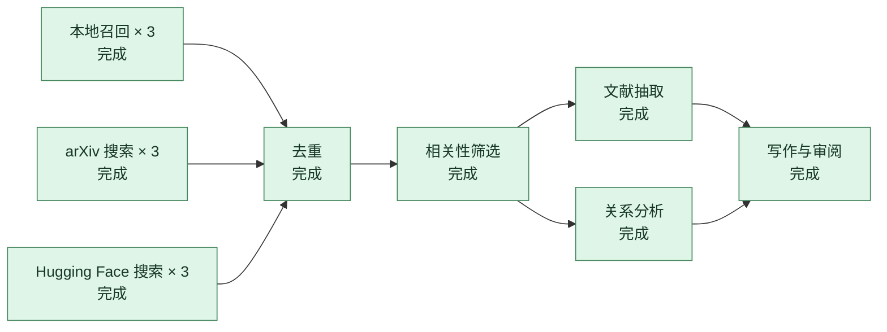

# nerf-foundations / external-abstract / r1

[← 返回 Survey Benchmark](../README.md)

原始工作台实测 · `89dc828fd629` · 完成

## 运行结果

| 指标 | 结果 |
| --- | --- |
| 严格交付 | 通过 |
| Faithfulness（门槛 ≥ 0.95） | 97.02%（553/570） |
| 引用 ID 有效性 | 100.00% |
| 内部一致性 | 100.00% |
| 终稿引用精确率 | 25.00% |
| 未获支持 / 未核验断言 | 17 / 0 |
| 矛盾对 | 0 |
| 独立 Judge | 未运行 |

## 任务流程

同类任务在终态和依赖关系一致时合并显示。箭头来自已归档的任务依赖。

## 阶段耗时与用量

| 阶段或边界 | 记录 |
| --- | --- |
| 提交到首个有效步骤 | 6.6 秒 |
| 提交到首份可读草稿 | 631.9 秒 |
| 提交到终态可见 | 1,048.5 秒 |
| 提交到终稿可读 | 1,048.7 秒 |
| 归档总耗时 | 1,034.5 秒 |
| 规划 | 2.5 秒 |
| 搜索与召回 | 12.8 秒 |
| 去重与筛选 | 3.1 秒 |
| 全文获取 | 29.2 秒 |
| 抽取（含全文获取） | 251.4 秒 |
| 写作与审阅 | 363.8 秒 |
| 初稿写作 1 | 351.0 秒 |
| 审阅 1 | 11.8 秒 |
| 首次 Evaluation 1 | 387.1 秒 |
| 已记录模型请求 | 45 |
| 已结算 Tokens | 409,978 |

— 表示归档未提供有效测量。阶段可能并行，耗时不能相加。

## 版本与归档

| 记录 | 结果 |
| --- | --- |
| 初稿 | 1 条 |
| 首次 Evaluation | 1 条 |
| 单独修订版本 | 未记录 |
| 复评 | 未记录 |
| 写作与修订记录 | 1 条 |
| 开始 / 结束 | `2026-11-24T14:17:32+00:00` / `2026-11-24T14:34:46+00:00` |
| 源运行归档 SHA-256 | `05a3d118095755b6e687b68e405f337ef1a285d49278b7b1401db296680abb76` |
| 报告内容 SHA-256 | `c9aa5fb8a6f39366b05c9d9297ba603ff3d86b651cb9d218f6610f263f117287` |
