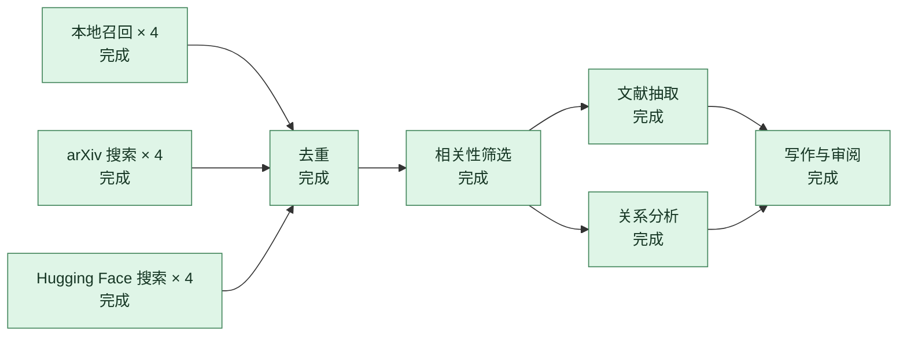

# vit-foundations / external-abstract / r1

[← 返回 Survey Benchmark](../README.md)

原始工作台实测 · `9ef7e1b9c2a5` · 完成

## 运行结果

| 指标 | 结果 |
| --- | --- |
| 严格交付 | 通过 |
| Faithfulness（门槛 ≥ 0.95） | 98.71%（612/620） |
| 引用 ID 有效性 | 100.00% |
| 内部一致性 | 100.00% |
| 终稿引用精确率 | 25.00% |
| 未获支持 / 未核验断言 | 8 / 0 |
| 矛盾对 | 0 |
| 独立 Judge | 未运行 |

## 任务流程

同类任务在终态和依赖关系一致时合并显示。箭头来自已归档的任务依赖。

## 阶段耗时与用量

| 阶段或边界 | 记录 |
| --- | --- |
| 提交到首个有效步骤 | 1.0 秒 |
| 提交到首份可读草稿 | 687.2 秒 |
| 提交到终态可见 | 1,153.7 秒 |
| 提交到终稿可读 | 1,153.8 秒 |
| 归档总耗时 | 1,136.8 秒 |
| 规划 | 3.2 秒 |
| 搜索与召回 | 8.4 秒 |
| 去重与筛选 | 5.9 秒 |
| 全文获取 | 4.9 秒 |
| 抽取（含全文获取） | 234.2 秒 |
| 写作与审阅 | 443.4 秒 |
| 初稿写作 1 | 430.1 秒 |
| 审阅 1 | 11.9 秒 |
| 首次 Evaluation 1 | 436.1 秒 |
| 已记录模型请求 | 45 |
| 已结算 Tokens | 439,234 |

— 表示归档未提供有效测量。阶段可能并行，耗时不能相加。

## 版本与归档

| 记录 | 结果 |
| --- | --- |
| 初稿 | 1 条 |
| 首次 Evaluation | 1 条 |
| 单独修订版本 | 未记录 |
| 复评 | 未记录 |
| 写作与修订记录 | 1 条 |
| 开始 / 结束 | `2026-11-24T13:58:10+00:00` / `2026-11-24T14:17:06+00:00` |
| 源运行归档 SHA-256 | `b30d752f0e1262fd7897f8ea9d63fd073fd3eab727e2a811a46c40a197976cfc` |
| 报告内容 SHA-256 | `f855e81f84de4fb56cb5c10cfaefd0c37eefa66cfa7b6a8ff6e3402277ba0a55` |
