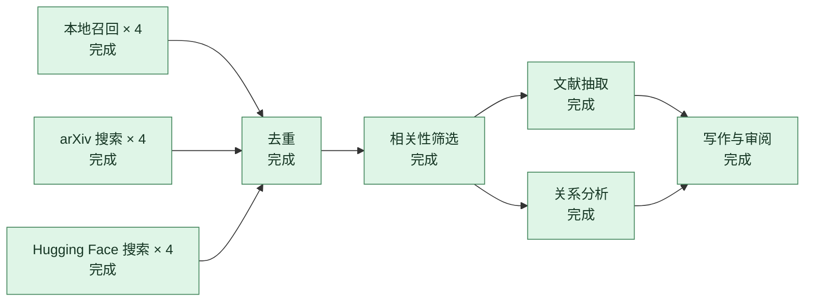

# few-shot-metric / external-abstract / r1

[← 返回 Survey Benchmark](../README.md)

原始工作台实测 · `c4b4fdb92580` · 完成

## 运行结果

| 指标 | 结果 |
| --- | --- |
| 严格交付 | 未通过 |
| Faithfulness（门槛 ≥ 0.95） | 96.39%（587/609） |
| 引用 ID 有效性 | 100.00% |
| 内部一致性 | 100.00% |
| 终稿引用精确率 | 50.00% |
| 未获支持 / 未核验断言 | 22 / 0 |
| 矛盾对 | 0 |
| 独立 Judge | 未运行 |

归档阻塞项包括 预算账本绑定失败。

## 任务流程

同类任务在终态和依赖关系一致时合并显示。箭头来自已归档的任务依赖。

## 阶段耗时与用量

| 阶段或边界 | 记录 |
| --- | --- |
| 提交到首个有效步骤 | 0.5 秒 |
| 提交到首份可读草稿 | 574.4 秒 |
| 提交到终态可见 | 966.8 秒 |
| 提交到终稿可读 | 966.9 秒 |
| 归档总耗时 | 960.4 秒 |
| 规划 | 3.2 秒 |
| 搜索与召回 | 41.5 秒 |
| 去重与筛选 | 5.3 秒 |
| 全文获取 | 0.8 秒 |
| 抽取（含全文获取） | 204.8 秒 |
| 写作与审阅 | 337.4 秒 |
| 初稿写作 1 | 315.7 秒 |
| 审阅 1 | 21.2 秒 |
| 首次 Evaluation 1 | 359.8 秒 |
| 已记录模型请求 | 45 |
| 已结算 Tokens | 427,627 |

— 表示归档未提供有效测量。阶段可能并行，耗时不能相加。

## 版本与归档

| 记录 | 结果 |
| --- | --- |
| 初稿 | 1 条 |
| 首次 Evaluation | 1 条 |
| 单独修订版本 | 未记录 |
| 复评 | 未记录 |
| 写作与修订记录 | 1 条 |
| 开始 / 结束 | `2026-11-24T08:58:21+00:00` / `2026-11-24T09:14:21+00:00` |
| 源运行归档 SHA-256 | `c24cc509646d4b73be4010dfbfea81373a4cf5fbe949b7530f1f85ea95e73873` |
| 报告内容 SHA-256 | `b2d1a209029cfebe0a82ebc6c5014d0ae9fd5649ee90eb15ab0abb9b380771fd` |
