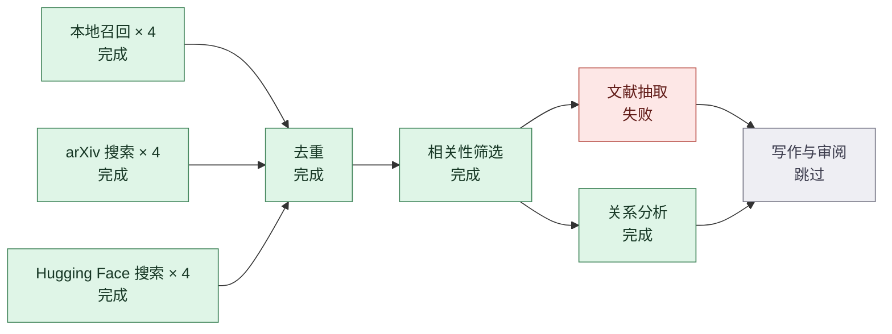

# few-shot-metric / external-abstract / r1

[← 返回 Survey Benchmark](../README.md)

工作台诊断复验 · `decdecd2e3ec` · 完成

## 运行结果

| 指标 | 结果 |
| --- | --- |
| 严格交付 | 未通过 |
| Faithfulness（门槛 ≥ 0.95） | — |
| 引用 ID 有效性 | — |
| 内部一致性 | — |
| 未获支持 / 未核验断言 | — / — |
| 矛盾对 | — |
| 独立 Judge | 未运行 |

归档阻塞项包括 文献抽取请求超时、Evaluation 未通过、报告未完成、无可用终稿。

## 任务流程

同类任务在终态和依赖关系一致时合并显示。箭头来自已归档的任务依赖。

## 阶段耗时与用量

| 阶段或边界 | 记录 |
| --- | --- |
| 提交到首个有效步骤 | 1.1 秒 |
| 提交到首份可读草稿 | — |
| 提交到终态可见 | 340.4 秒 |
| 提交到终稿可读 | — |
| 归档总耗时 | 339.3 秒 |
| 规划 | 3.4 秒 |
| 搜索与召回 | 90.1 秒 |
| 去重与筛选 | 3.5 秒 |
| 全文获取 | 1.4 秒 |
| 抽取（含全文获取） | 241.6 秒 |
| 已记录模型请求 | 27 |
| Tokens（部分用量未确认） | 97,858 |

— 表示归档未提供有效测量。阶段可能并行，耗时不能相加。

## 版本与归档

| 记录 | 结果 |
| --- | --- |
| 初稿 | 未记录 |
| 首次 Evaluation | 未记录 |
| 单独修订版本 | 未记录 |
| 复评 | 未记录 |
| 写作与修订记录 | 未记录 |
| 开始 / 结束 | `2026-11-24T12:54:04+00:00` / `2026-11-24T12:59:43+00:00` |
| 源运行归档 SHA-256 | `51bad376d3209afc0fbf6b47e8be89c1bcd9e7686e4c0ccac0d95028c7fb9a7b` |
| 报告内容 SHA-256 | `f3ff400c2ef085f90039f2f3a25043236e7ee350b1b55f755a722558920e7276` |
