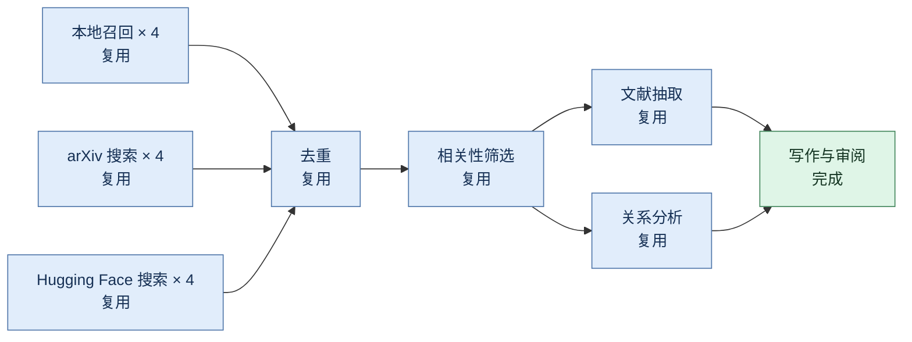

# few-shot-metric / external-abstract / r1

[← 返回 Survey Benchmark](../README.md)

摘要检查点续跑 · `replay-few-shot-metric-external-abstract-r1-retry-784e96a6da72` · 完成

## 运行结果

| 指标 | 结果 |
| --- | --- |
| 严格交付 | 通过 |
| Faithfulness（门槛 ≥ 0.95） | 99.80%（510/511） |
| 引用 ID 有效性 | 100.00% |
| 内部一致性 | 100.00% |
| 终稿引用精确率 | 50.00% |
| 未获支持 / 未核验断言 | 1 / 0 |
| 矛盾对 | 0 |
| 独立 Judge | 未运行 |

## 任务流程

同类任务在终态和依赖关系一致时合并显示。箭头来自已归档的任务依赖。

复用了 `replay-few-shot-metric-external-abstract-r1` 的 16 个已完成任务。复用节点没有本次耗时或模型用量。

## 阶段耗时与用量

| 阶段或边界 | 记录 |
| --- | --- |
| 摘要检查点到 Survey 完成 | 875.1 秒 |
| 归档总耗时 | 875.8 秒 |
| 写作与审阅 | 70.1 秒 |
| 初稿写作 1 | 29.5 秒 |
| 审阅 1 | 40.6 秒 |
| 首次 Evaluation 1 | 364.9 秒 |
| 修订（含准备） 1 | 80.9 秒 |
| 复评 1 | 348.1 秒 |
| 已记录模型请求 | 18 |
| 已结算 Tokens | 432,083 |

— 表示归档未提供有效测量。阶段可能并行，耗时不能相加。

## 版本与归档

| 记录 | 结果 |
| --- | --- |
| 初稿 | 1 条 |
| 首次 Evaluation | 1 条 |
| 单独修订版本 | 未记录 |
| 复评 | 1 条 |
| 写作与修订记录 | 1 条 |
| 开始 / 结束 | `2026-11-26T02:06:16+00:00` / `2026-11-26T02:20:52+00:00` |
| 原始运行 | [`replay-few-shot-metric-external-abstract-r1`](replay-few-shot-metric-external-abstract-r1.md) |
| 源运行归档 SHA-256 | `455fa0aa55e4ac27a1bae97afe744c2d8754a2faf1fe93c4c542dc8a977e74ec` |
| 报告内容 SHA-256 | `4db726179d799be81a638b09d478091d544872f7b3d95376e668baa9a6b2fd64` |
