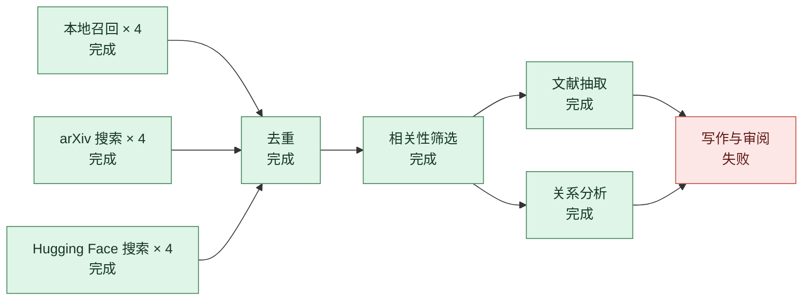

# few-shot-metric / external-fulltext / r1

[← 返回 Survey Benchmark](../README.md)

原始受控回放 · `replay-few-shot-metric-external-fulltext-r1` · 完成

## 运行结果

| 指标 | 结果 |
| --- | --- |
| 严格交付 | 未通过 |
| Faithfulness（门槛 ≥ 0.95） | — |
| 引用 ID 有效性 | — |
| 内部一致性 | — |
| 未获支持 / 未核验断言 | — / — |
| 矛盾对 | — |
| 独立 Judge | 未运行 |

归档阻塞项包括 摘要或结论超过长度上限、Evaluation 未通过、报告未完成。

## 任务流程

同类任务在终态和依赖关系一致时合并显示。箭头来自已归档的任务依赖。

## 阶段耗时与用量

| 阶段或边界 | 记录 |
| --- | --- |
| 外部输入就绪到 Survey 完成 | 557.4 秒 |
| 归档总耗时 | 558.4 秒 |
| 规划 | 0.0 秒 |
| 搜索与召回 | 0.3 秒 |
| 去重与筛选 | 6.6 秒 |
| 全文获取 | 6.1 秒 |
| 抽取（含全文获取） | 240.0 秒 |
| 写作与审阅 | 310.0 秒 |
| 初稿写作 1 | 309.1 秒 |
| 已记录模型请求 | 36 |
| 已结算 Tokens | 236,290 |

— 表示归档未提供有效测量。阶段可能并行，耗时不能相加。

## 版本与归档

| 记录 | 结果 |
| --- | --- |
| 初稿 | 未记录 |
| 首次 Evaluation | 未记录 |
| 单独修订版本 | 未记录 |
| 复评 | 未记录 |
| 写作与修订记录 | 1 条 |
| 开始 / 结束 | `2026-11-24T14:53:00+00:00` / `2026-11-24T15:02:18+00:00` |
| 源运行归档 SHA-256 | `87845a4525d8787410ae10d768a0a33fd9b0f989c2fdcb79c162f9b98f4bb564` |
| 报告内容 SHA-256 | `8c8205bbbf6594919fc2d415c367e049c0691252a9c32d20bcca2e087e3fbaa2` |
