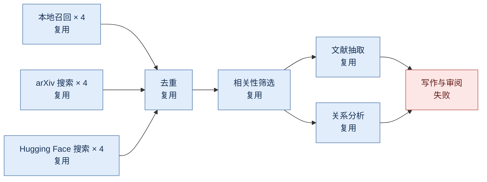

# few-shot-metric / external-only / r2

[← 返回 Survey Benchmark](../README.md)

摘要检查点续跑 · `replay-few-shot-metric-external-only-r2-retry-11c205c4ab91` · 失败

## 运行结果

| 指标 | 结果 |
| --- | --- |
| 严格交付 | 未取得交付判定 |
| Faithfulness（门槛 ≥ 0.95） | — |
| 引用 ID 有效性 | — |
| 内部一致性 | — |
| 未获支持 / 未核验断言 | — / — |
| 矛盾对 | — |
| 独立 Judge | 未运行 |

归档阻塞项包括 摘要或结论超过长度上限。

## 任务流程

同类任务在终态和依赖关系一致时合并显示。箭头来自已归档的任务依赖。

复用了 `replay-few-shot-metric-external-only-r2` 的 16 个已完成任务。复用节点没有本次耗时或模型用量。

## 阶段耗时与用量

| 阶段或边界 | 记录 |
| --- | --- |
| 摘要检查点到 Survey 完成 | — |
| 归档总耗时 | 82.2 秒 |
| 写作与审阅 | 75.6 秒 |
| 初稿写作 1 | 75.6 秒 |
| 已记录模型请求 | 3 |
| 已结算 Tokens | 78,619 |

— 表示归档未提供有效测量。阶段可能并行，耗时不能相加。

## 版本与归档

| 记录 | 结果 |
| --- | --- |
| 初稿 | 未记录 |
| 首次 Evaluation | 未记录 |
| 单独修订版本 | 未记录 |
| 复评 | 未记录 |
| 写作与修订记录 | 1 条 |
| 开始 / 结束 | `2026-11-26T02:41:49+00:00` / `2026-11-26T02:43:12+00:00` |
| 原始运行 | [`replay-few-shot-metric-external-only-r2`](replay-few-shot-metric-external-only-r2.md) |
| 源运行归档 SHA-256 | `bb70bdeb808d5bbc6d4bdbf6420c7aa3d9e00182c04767ecd1a2181215e4a92e` |
