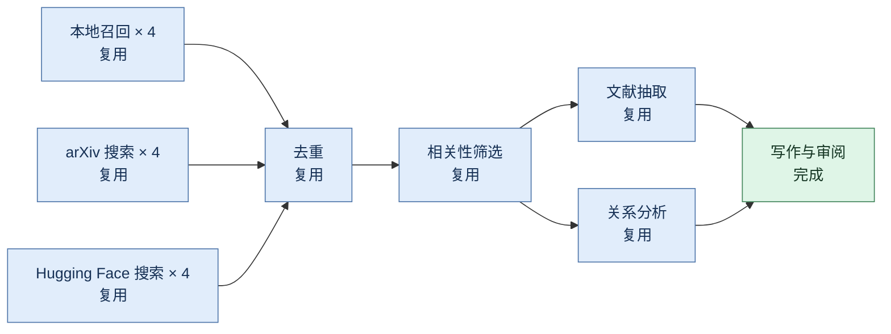

# few-shot-metric / external-only / r2

[← 返回 Survey Benchmark](../README.md)

摘要重建续跑 · `replay-few-shot-metric-external-only-r2-retry-70a2fbdbbf80` · 完成

## 运行结果

| 指标 | 结果 |
| --- | --- |
| 严格交付 | 未通过 |
| Faithfulness（门槛 ≥ 0.95） | 94.14%（626/665） |
| 引用 ID 有效性 | 100.00% |
| 内部一致性 | 100.00% |
| 未获支持 / 未核验断言 | 39 / 0 |
| 矛盾对 | 0 |
| 独立 Judge | 未运行 |

归档阻塞项包括 Evaluation 未通过、自动交付检查未通过、科学断言支持率未达门槛。

## 任务流程

同类任务在终态和依赖关系一致时合并显示。箭头来自已归档的任务依赖。

复用了 `replay-few-shot-metric-external-only-r2` 的 16 个已完成任务。复用节点没有本次耗时或模型用量。

## 阶段耗时与用量

| 阶段或边界 | 记录 |
| --- | --- |
| 摘要检查点到 Survey 完成 | 2,745.6 秒 |
| 归档总耗时 | 2,747.0 秒 |
| 写作与审阅 | 58.7 秒 |
| 初稿写作 1 | 21.9 秒 |
| 审阅 1 | 36.6 秒 |
| 首次 Evaluation 1 | 426.1 秒 |
| 修订（含准备） 1 | 80.1 秒 |
| 修订（含准备） 2 | 89.6 秒 |
| 修订（含准备） 3 | 80.8 秒 |
| 修订（含准备） 4 | 82.1 秒 |
| 修订（含准备） 5 | 80.9 秒 |
| 复评 1 | 346.7 秒 |
| 复评 2 | 370.6 秒 |
| 复评 3 | 368.5 秒 |
| 复评 4 | 354.1 秒 |
| 复评 5 | 394.7 秒 |
| 已记录模型请求 | 54 |
| 已结算 Tokens | 1,346,630 |

— 表示归档未提供有效测量。阶段可能并行，耗时不能相加。

## 版本与归档

| 记录 | 结果 |
| --- | --- |
| 初稿 | 1 条 |
| 首次 Evaluation | 1 条 |
| 单独修订版本 | 未记录 |
| 复评 | 5 条 |
| 写作与修订记录 | 1 条 |
| 开始 / 结束 | `2026-11-26T03:16:48+00:00` / `2026-11-26T04:02:35+00:00` |
| 原始运行 | [`replay-few-shot-metric-external-only-r2`](replay-few-shot-metric-external-only-r2.md) |
| 前一次摘要修复 | [`replay-few-shot-metric-external-only-r2-retry-11c205c4ab91`](replay-few-shot-metric-external-only-r2-retry-11c205c4ab91.md) |
| 源运行归档 SHA-256 | `aac89e3b0957657e7f8c4474e039edb84032feff1fe29d862d7aebdcb9b79ee0` |
| 报告内容 SHA-256 | `cb13f995ae1ea06041547f24286bd923620177bf6c4d0b38bd967ad23a5fe743` |
