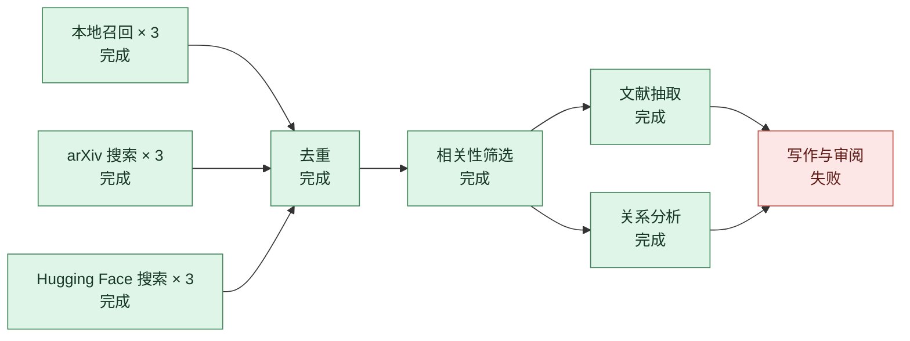

# nerf-foundations / external-only / r2

[← 返回 Survey Benchmark](../README.md)

原始受控回放 · `replay-nerf-foundations-external-only-r2` · 完成

## 运行结果

| 指标 | 结果 |
| --- | --- |
| 严格交付 | 未通过 |
| Faithfulness（门槛 ≥ 0.95） | — |
| 引用 ID 有效性 | — |
| 内部一致性 | — |
| 未获支持 / 未核验断言 | — / — |
| 矛盾对 | — |
| 独立 Judge | 未运行 |

归档阻塞项包括 模型供应商拒绝请求、Evaluation 未通过、报告未完成。

## 任务流程

同类任务在终态和依赖关系一致时合并显示。箭头来自已归档的任务依赖。

## 阶段耗时与用量

| 阶段或边界 | 记录 |
| --- | --- |
| 外部输入就绪到 Survey 完成 | 483.4 秒 |
| 归档总耗时 | 484.2 秒 |
| 规划 | 0.0 秒 |
| 搜索与召回 | 0.0 秒 |
| 去重与筛选 | 1.7 秒 |
| 全文获取 | 40.9 秒 |
| 抽取（含全文获取） | 216.2 秒 |
| 写作与审阅 | 265.1 秒 |
| 初稿写作 1 | 265.0 秒 |
| 已记录模型请求 | 31 |
| Tokens（部分用量未确认） | 199,758 |

— 表示归档未提供有效测量。阶段可能并行，耗时不能相加。

## 版本与归档

| 记录 | 结果 |
| --- | --- |
| 初稿 | 未记录 |
| 首次 Evaluation | 未记录 |
| 单独修订版本 | 未记录 |
| 复评 | 未记录 |
| 写作与修订记录 | 1 条 |
| 开始 / 结束 | `2026-11-25T08:59:47+00:00` / `2026-11-25T09:07:51+00:00` |
| 源运行归档 SHA-256 | `05ddfa662e3cbc0f5eea7641a75cdc3359eabcf6ae846bc4b7d522af2883528f` |
| 报告内容 SHA-256 | `b7c11428011fc767af78479377c2b5c665e1f9364df8ecebb07f3fb1e5ad976f` |
