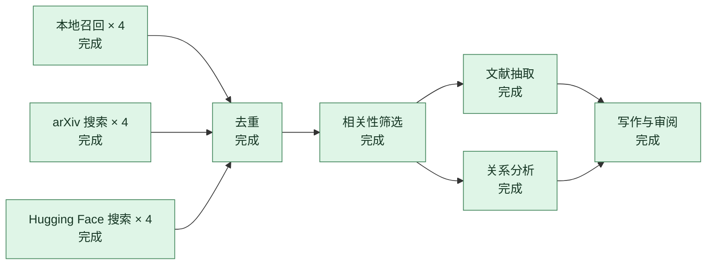

# vit-foundations / external-abstract / r2

[← 返回 Survey Benchmark](../README.md)

原始受控回放 · `replay-vit-foundations-external-abstract-r2` · 完成

## 运行结果

| 指标 | 结果 |
| --- | --- |
| 严格交付 | 通过 |
| Faithfulness（门槛 ≥ 0.95） | 100.00%（715/715） |
| 引用 ID 有效性 | 100.00% |
| 内部一致性 | 100.00% |
| 终稿引用精确率 | 25.00% |
| 未获支持 / 未核验断言 | 0 / 0 |
| 矛盾对 | 0 |
| 独立 Judge | 未运行 |

## 任务流程

同类任务在终态和依赖关系一致时合并显示。箭头来自已归档的任务依赖。

## 阶段耗时与用量

| 阶段或边界 | 记录 |
| --- | --- |
| 外部输入就绪到 Survey 完成 | 1,692.2 秒 |
| 归档总耗时 | 1,693.7 秒 |
| 规划 | 0.0 秒 |
| 搜索与召回 | 0.1 秒 |
| 去重与筛选 | 3.1 秒 |
| 全文获取 | 72.4 秒 |
| 抽取（含全文获取） | 300.4 秒 |
| 写作与审阅 | 354.0 秒 |
| 初稿写作 1 | 332.5 秒 |
| 审阅 1 | 21.4 秒 |
| 首次 Evaluation 1 | 476.2 秒 |
| 修订（含准备） 1 | 82.2 秒 |
| 复评 1 | 475.6 秒 |
| 已记录模型请求 | 53 |
| 已结算 Tokens | 675,239 |

— 表示归档未提供有效测量。阶段可能并行，耗时不能相加。

## 版本与归档

| 记录 | 结果 |
| --- | --- |
| 初稿 | 1 条 |
| 首次 Evaluation | 1 条 |
| 单独修订版本 | 未记录 |
| 复评 | 1 条 |
| 写作与修订记录 | 1 条 |
| 开始 / 结束 | `2026-11-25T08:17:08+00:00` / `2026-11-25T08:45:22+00:00` |
| 源运行归档 SHA-256 | `59859e9ef405464439a1440879f2f987ce731b930b8fe6d1573e6f1d61d2d49f` |
| 报告内容 SHA-256 | `721eb6cf7a903e47588ffae75298dccfc177145aa4a056986ee25e9adf82bae3` |
