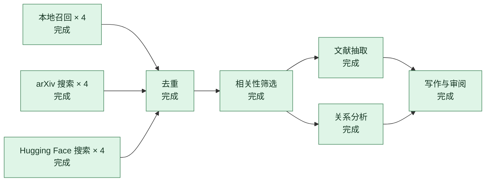

# vit-foundations / external-fulltext / r1

[← 返回 Survey Benchmark](../README.md)

原始受控回放 · `replay-vit-foundations-external-fulltext-r1` · 完成

## 运行结果

| 指标 | 结果 |
| --- | --- |
| 严格交付 | 通过 |
| Faithfulness（门槛 ≥ 0.95） | 98.43%（815/828） |
| 引用 ID 有效性 | 100.00% |
| 内部一致性 | 100.00% |
| 终稿引用精确率 | 25.00% |
| 未获支持 / 未核验断言 | 13 / 0 |
| 矛盾对 | 0 |
| 独立 Judge | 未运行 |

## 任务流程

同类任务在终态和依赖关系一致时合并显示。箭头来自已归档的任务依赖。

## 阶段耗时与用量

| 阶段或边界 | 记录 |
| --- | --- |
| 外部输入就绪到 Survey 完成 | 1,123.4 秒 |
| 归档总耗时 | 1,125.3 秒 |
| 规划 | 0.0 秒 |
| 搜索与召回 | 0.2 秒 |
| 去重与筛选 | 3.4 秒 |
| 全文获取 | 18.4 秒 |
| 抽取（含全文获取） | 276.2 秒 |
| 写作与审阅 | 343.6 秒 |
| 初稿写作 1 | 334.3 秒 |
| 审阅 1 | 9.2 秒 |
| 首次 Evaluation 1 | 499.3 秒 |
| 已记录模型请求 | 44 |
| 已结算 Tokens | 511,015 |

— 表示归档未提供有效测量。阶段可能并行，耗时不能相加。

## 版本与归档

| 记录 | 结果 |
| --- | --- |
| 初稿 | 1 条 |
| 首次 Evaluation | 1 条 |
| 单独修订版本 | 未记录 |
| 复评 | 未记录 |
| 写作与修订记录 | 1 条 |
| 开始 / 结束 | `2026-11-24T15:11:43+00:00` / `2026-11-24T15:30:28+00:00` |
| 源运行归档 SHA-256 | `d67b52cfab7b61fa15480492441fb6e8c786f8859fd85345769a808d952aba2f` |
| 报告内容 SHA-256 | `6a4096b70cda2354f84285037cf7647b29a730ce198b89064877bdaf4bc8d6be` |
