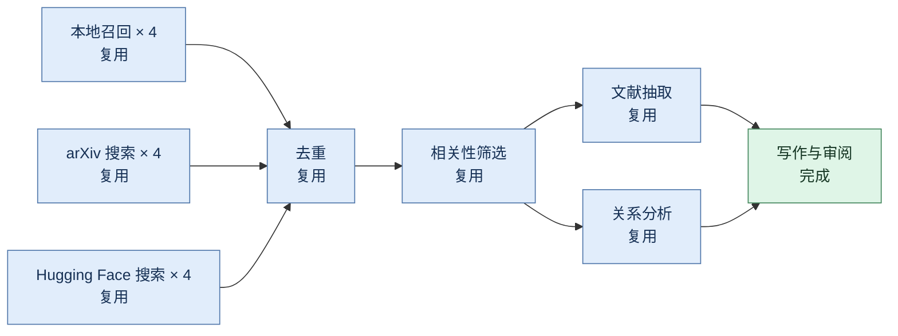

# vit-foundations / external-fulltext / r2

[← 返回 Survey Benchmark](../README.md)

摘要检查点续跑 · `replay-vit-foundations-external-fulltext-r2-retry-6c840c5a854e` · 完成

## 运行结果

| 指标 | 结果 |
| --- | --- |
| 严格交付 | 通过 |
| Faithfulness（门槛 ≥ 0.95） | 98.79%（652/660） |
| 引用 ID 有效性 | 100.00% |
| 内部一致性 | 100.00% |
| 终稿引用精确率 | 0.00% |
| 未获支持 / 未核验断言 | 8 / 0 |
| 矛盾对 | 0 |
| 独立 Judge | 未运行 |

## 任务流程

同类任务在终态和依赖关系一致时合并显示。箭头来自已归档的任务依赖。

复用了 `replay-vit-foundations-external-fulltext-r2` 的 16 个已完成任务。复用节点没有本次耗时或模型用量。

## 阶段耗时与用量

| 阶段或边界 | 记录 |
| --- | --- |
| 摘要检查点到 Survey 完成 | 506.9 秒 |
| 归档总耗时 | 508.5 秒 |
| 写作与审阅 | 72.6 秒 |
| 初稿写作 1 | 23.9 秒 |
| 审阅 1 | 48.6 秒 |
| 首次 Evaluation 1 | 427.6 秒 |
| 已记录模型请求 | 9 |
| 已结算 Tokens | 252,939 |

— 表示归档未提供有效测量。阶段可能并行，耗时不能相加。

## 版本与归档

| 记录 | 结果 |
| --- | --- |
| 初稿 | 1 条 |
| 首次 Evaluation | 1 条 |
| 单独修订版本 | 未记录 |
| 复评 | 未记录 |
| 写作与修订记录 | 1 条 |
| 开始 / 结束 | `2026-11-26T02:43:12+00:00` / `2026-11-26T02:51:41+00:00` |
| 原始运行 | [`replay-vit-foundations-external-fulltext-r2`](replay-vit-foundations-external-fulltext-r2.md) |
| 源运行归档 SHA-256 | `eb7ed7fc4f36e19950cadf433d1e3add6fe46106f150e0299f5c8acbfa9c8685` |
| 报告内容 SHA-256 | `dd58c0bc822211fff91213d8dbead2e4ede6fa2293e6ba0d2e4c8f3697e5390a` |
