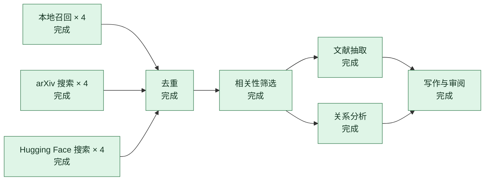

# vit-foundations / external-only / r2

[← 返回 Survey Benchmark](../README.md)

原始受控回放 · `replay-vit-foundations-external-only-r2` · 完成

## 运行结果

| 指标 | 结果 |
| --- | --- |
| 严格交付 | 通过 |
| Faithfulness（门槛 ≥ 0.95） | 98.90%（538/544） |
| 引用 ID 有效性 | 100.00% |
| 内部一致性 | 100.00% |
| 终稿引用精确率 | 50.00% |
| 未获支持 / 未核验断言 | 6 / 0 |
| 矛盾对 | 0 |
| 独立 Judge | 未运行 |

## 任务流程

同类任务在终态和依赖关系一致时合并显示。箭头来自已归档的任务依赖。

## 阶段耗时与用量

| 阶段或边界 | 记录 |
| --- | --- |
| 外部输入就绪到 Survey 完成 | 1,485.5 秒 |
| 归档总耗时 | 1,486.9 秒 |
| 规划 | 0.0 秒 |
| 搜索与召回 | 0.0 秒 |
| 去重与筛选 | 2.1 秒 |
| 全文获取 | 72.4 秒 |
| 抽取（含全文获取） | 282.9 秒 |
| 写作与审阅 | 318.0 秒 |
| 初稿写作 1 | 307.3 秒 |
| 审阅 1 | 10.7 秒 |
| 首次 Evaluation 1 | 404.3 秒 |
| 修订（含准备） 1 | 92.7 秒 |
| 复评 1 | 385.0 秒 |
| 已记录模型请求 | 53 |
| 已结算 Tokens | 628,681 |

— 表示归档未提供有效测量。阶段可能并行，耗时不能相加。

## 版本与归档

| 记录 | 结果 |
| --- | --- |
| 初稿 | 1 条 |
| 首次 Evaluation | 1 条 |
| 单独修订版本 | 未记录 |
| 复评 | 1 条 |
| 写作与修订记录 | 1 条 |
| 开始 / 结束 | `2026-11-25T07:42:18+00:00` / `2026-11-25T08:07:04+00:00` |
| 源运行归档 SHA-256 | `73bfb1147b9a4a0e0a8d94edc01c896e6f5f3fdde767886e2e34a699fc236152` |
| 报告内容 SHA-256 | `e403d50224f03c0410641fef19016fdfebe34805b5c6dd7c666275be69070fd3` |
