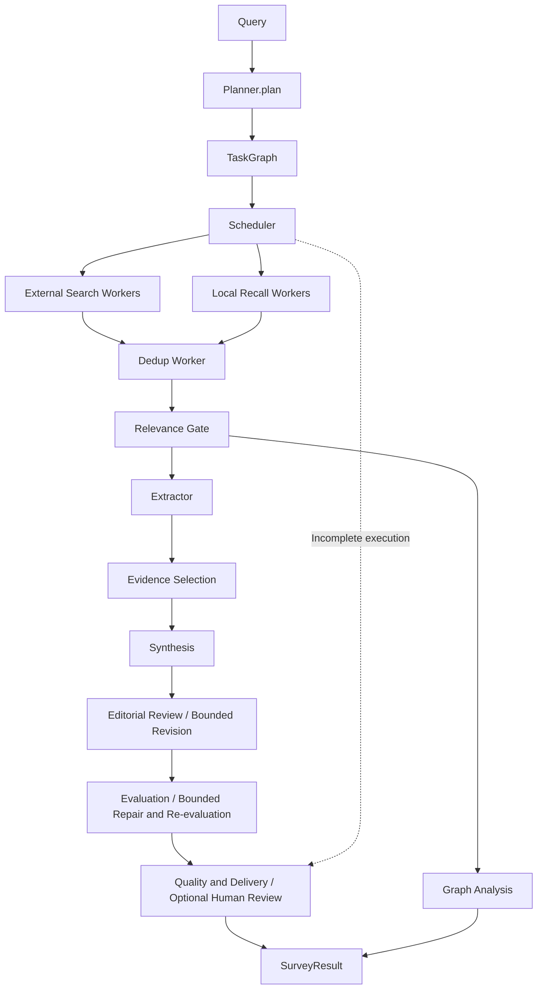
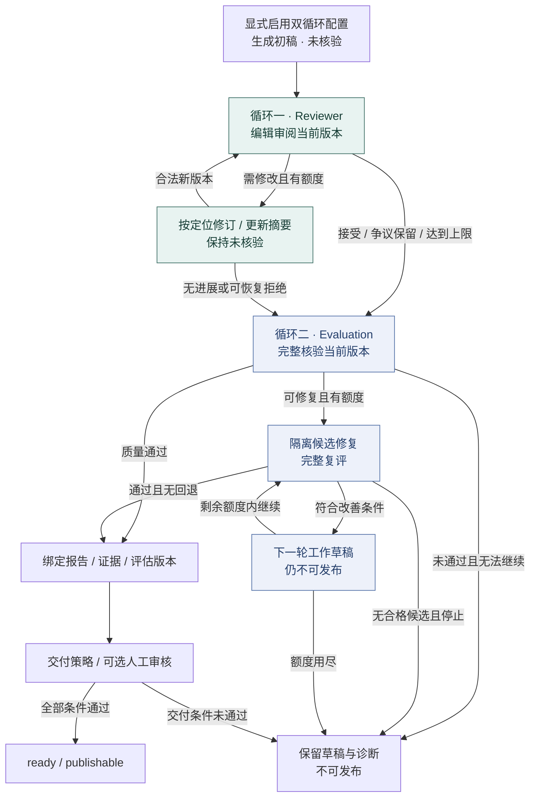

# LitAgent System Overview

This document describes the public, implementation-backed architecture at the
module and data-contract level. Function-level learning notes are intentionally
kept outside the public project documentation.

Architecture checked against `bdfecbd` on 2026-11-12. The independent editorial
and Evaluation loops are opt-in; their presence does not change historical
configuration or establish a new live benchmark result.
[中文首页](../README.md) · [English overview](../README.en.md).

## Runtime Ownership

`LitAgent` in `runner.py` is the composition root. It creates shared Redis,
Qdrant, and PostgreSQL handles, wires workers and evaluators, owns the run
lifecycle, and closes resources exactly once. Optional infrastructure failures
degrade the corresponding capability without silently changing the final report
contract.

The public report is always a `SurveyResult` containing the survey text,
metadata, review history, graph data, execution completeness, evaluation,
quality, and delivery. API and CLI surfaces consume the same contract.

## Runtime Data Flow

The scheduler injects completed dependency outputs into each downstream task.
Workers therefore consume explicit upstream contracts rather than reading a
global mutable result map. Timeout, cancellation, and dependency failure are
converted into failed, cancelled, or skipped terminal states.

`TaskGraph` and `Scheduler` implement the Survey DAG using asyncio. LangGraph's
`StateGraph` implements the ReAct subflow in `agent/react.py`; it is not the
Survey scheduler. The current structured writer uses `WriterSession` directly,
while older non-strict generation paths can use ReAct. The diagram groups
capabilities; it does not imply that every profile takes every repair branch.

## Independent Review and Evaluation Loops

The following flow applies only to the explicitly selected
[independent-loop profile](../config/separate-review-evaluation.yaml), with frozen
`configured-run-limits-v6` resource identity. It uses
`separate-review-evaluation-v1` and independently reserves editorial revision,
Evaluation revision, capacity repair and inventory recovery allowances. Legacy
profiles and settled historical journals retain their original semantics.

Technical failures, cancellation and incomplete execution stop with a non-publishable
result according to their actual state; no error path grants publication. This
diagram shows the semantic loops. Technical protocol retries and capacity/inventory
recovery remain bounded subpaths, not additional semantic review loops. Failed
candidates may consume remaining attempts without replacing the working draft;
the diagram shows their eventual stop outcome rather than every retry edge.

- **Editorial review:** at most three editorial revisions, with a review of each
  retained version. No issues, exhausted allowance, unchanged or repeated output,
  or a recoverable rejected edit ends the loop with the last valid draft. Other
  technical failures stop the run. Editorial acceptance never marks science as
  verified, and unresolved editorial disputes are passed to independent Evaluation.
- **Evaluation repair:** at most three independently budgeted revisions. A
  candidate is fully re-evaluated against its own version. A fully assessed
  reduction in source-bound problem groups, with no previously passed check
  regressing, may become the next working draft; it remains non-publishable until
  all required quality and delivery conditions pass. Capacity and inventory
  recovery each have a separate allowance of three.
- **Version ownership:** reviewer diagnostics, candidate lineage, report SHA and
  evaluation results remain aligned. UI projections expose editorial and
  Evaluation histories separately, without turning editorial scores into
  scientific support scores.

Implementation: [editorial coordinator](../src/litagent/review_cycles.py),
[policy and budgets](../src/litagent/review_policy.py),
[runner](../src/litagent/runner.py).
Verification: [pipeline](../tests/test_separate_review_pipeline.py),
[cycle contracts](../tests/test_separate_review_cycles.py),
[budget isolation](../tests/test_separate_review_budget.py).

## Paper and Evidence Contracts

External APIs and PDF ingestion differ in available content, but both are
normalized into shared paper and chunk contracts. An abstract is a valid chunk
with no page or bounding-box locator. Full-text chunks can additionally preserve
section, page, source block, and optional bounding-box provenance.

The evidence layer assigns stable evidence IDs and keeps the paper identity,
selected text, locator, confidence, and content scope together. Synthesis and
every adversarial revision round receive the same run-scoped evidence selection.
Cross-run trusted claims remain advisory context for the Reviewer and cannot
replace current-run evidence citations.

## Corpus and Retrieval

The manifest is the versioned corpus declaration. Raw assets are validated before
parsing, parsed text passes a quality gate, and the configured chunker creates
stable chunk identities. `CorpusState` in PostgreSQL records ingestion progress
and content, embedding-input, and payload hashes.

Qdrant stores named dense and BM25 sparse vectors. Retrieval supports dense,
sparse, and RRF modes, with optional CrossEncoder reranking. Collection identity
contains fields that affect stored vector compatibility; query-time experimental
settings belong to the profile fingerprint instead.

Incremental synchronization distinguishes unchanged content, vector changes,
payload-only changes, new chunks, and stale chunks. A collection rebuild clears
the matching incremental state before repopulation so an empty index cannot be
mistaken for an up-to-date one.

## Evaluation and Delivery

The default configuration uses RAGAS Faithfulness with the sources cited by
each report unit. The independent-loop profile uses the same engine. Historical
runs retain their original evaluation contract. The quality page shows citation
ID validity separately from scientific support. See [metric definitions](evaluation-results.md).

Reviewer makes editorial recommendations during writing. Evaluation checks the
report after writing and reassesses revision candidates. The workbench defaults
to `strict_auto_v2`, which requires complete verification, a scientific support
rate of 1.0, no contradictions and passing report checks. Jev is enabled by default
for extraction before writing. The final-report Judge is retired in the workbench.
Stage routing uses Lite for planning, extraction, review and evaluation, and Pro
for writing and revisions.

When evidence repair is attempted, the candidate report is kept isolated from the
publishable result until structure validation, reference validation and
post-rewrite evaluation succeed. The opt-in workflow can retain a verified
improvement as a non-publishable working draft for the next repair. A successful
commit binds survey, evaluation and quality to the same report version.

Delivery is a policy result, not another evaluator:

- execution incomplete takes precedence and produces `partial`
- complete execution with failed quality produces `blocked`
- unverified quality or critical degradation produces `needs_review`
- only complete, passed output produces `ready` and `publishable=true`

## Memory and Claims

- Working Memory uses Redis and TTL semantics for active-run context.
- Episodic Memory uses Qdrant for prior run summaries.
- Semantic and Procedural Memory use PostgreSQL.
- Claims Index stores only claims promoted after successful quality and delivery.

Content-bearing memory consolidation runs after evaluation and delivery. Reports
that are partial or not publishable cannot promote their content into trusted
cross-run memory.

## Observability and Replay

Runtime components emit stable lifecycle events for Survey, Worker, LLM, Tool,
RAG, Memory, Claims, Evaluation, and rewrite operations. `RunRecorder` consumes
the full local payload and pairs start/terminal events into execution nodes.

LangFuse receives a recursively redacted event projection. Credentials and
sensitive headers are removed while current controlled runs send metadata and usage only. Full prompts, selected
paper text and responses remain local; legacy traces may use their recorded policy. The local artifact and remote trace are linked
by an optional trace ID and URL.

The `/flow-demo` UI reads a server-side `FlowDemoView` projection. It does not
reimplement quality or delivery policy in JavaScript. Raw local artifacts remain
downloadable for detailed inspection.

## Persistence and Rebuild Boundaries

| Data | Source of truth | Lifecycle |
| --- | --- | --- |
| Corpus declaration | Versioned manifest | Durable |
| Raw PDF assets | Local artifact directory | Durable, private |
| Parsed chunks | Rebuildable artifact | Durable, private |
| Paper and claims vectors | Qdrant named volume | Rebuildable |
| Corpus incremental state | PostgreSQL named volume | Durable |
| Working Memory | Redis | TTL and disposable |
| Run replay | Local RunArtifact JSON | Durable, private |
| LangFuse trace | Optional LangFuse deployment | Operational telemetry |

## Degradation Boundaries

Unavailable Memory, Claims, local RAG, or one external source is represented by
stable reason codes and trace events. A fallback must preserve the public output
shape. Complete failure of relevant sources, incomplete DAG execution, failed
quality, and unverified quality remain distinct delivery outcomes.

## Public presentation boundary

`litagent demo --presentation` serves packaged fixtures and sanitized diagnostic
records. It denies mutations before dispatch, never opens private archive/SQLite
state, and does not initialize recovery, LLM clients or audit executors. The same
reader/citation/export contracts apply. Execution completion, verification and
publishability remain separate. See [release criteria](release.md).
